# Every action, what it takes and what comes of it

Prompt version 16 on. Each plan lists, numbered, the actions a villager can do then; this file shows,
for every action in the game, what puts it on that list and what comes of doing it. How plans fit
into a day and an hour is in [day_flow.md](day_flow.md); the code is `options.py` (the list) and
`world.py` (what happens). Generated by `scripts/actions_doc.py` from `data/island_world.yaml`;
rerun it after changing the world file or the rules.

Each action is a small graph with the action in the centre, what it takes on the left and what comes
of it on the right. What it takes, on the left:
- **green:** the action
- **blue, "needs in pockets":** what has to be in their pockets when they plan
- **orange, "done at":** where it happens; always somewhere they can walk to with the ladder and
  vaulting pole they carry, from where they are (the way is the same in both directions, so this
  holds wherever the plan takes them)
- **yellow, "only if":** anything else that has to be true when they plan

What comes of it, on the right:
- **teal, "gives":** what they get, with its chance
- **pink, "uses up":** what it costs them
- **grey, "changes":** what changes for them or on the island, recipes learned included

If anything it takes is missing, the action isn't on that plan's list; it shows up at a later plan
once everything is there. "One line per ..." means the list has a separate numbered line for each
one (each rock, each villager, each thing in stock). Above each graph is an example of the line the
villager sees, and below it what can still make it fail when its hour comes: something that changed
after the plan was made. Any action away from home can also fail if a ladder or vaulting pole broke
on an earlier trip and the place is now out of reach. Anything that gives things gives only what
fits in their pockets.

**The numbers are this world file's.** In runs, every species has an invented name ("selit fish"),
prices are jittered, and fish move to another water and other hours; the chances (rock yields, the
wood mix, shell, fish and bug weights, the bottle and the catch) stay as here. A tool wears by one use
each time an action uses it, and breaks at 30 uses.

The list is in the order of this file. The 40 entries are 35 kinds of action (`fish` has a second
entry for fishing with bait, and `buy` has four: things, tools, recipe cards and clothes) plus the
plaza, which takes the hour but isn't one of the day's actions. Proposing bridges and stairs, and a
fund for each, are from prompt version 17; everything else from 16.

One action can fail on where the villager is rather than on the plan: a proposal is made where they
stand at that hour, so it's on the list whenever a workable spot exists somewhere they can walk to,
and fails if there's none within 8 steps of where the plan has taken them by then (saying where
the nearest one is). From the moment a bridge or stairs is proposed, its whole footprint is a
construction site: walkable, but nothing can be planted or put on it, and no tree or rock turns up
there; that's why plant and place can't use those tiles.

## Gathering

### 1. `mine_rock`

On the list: *mine rock 3 (lower ground, centre)*

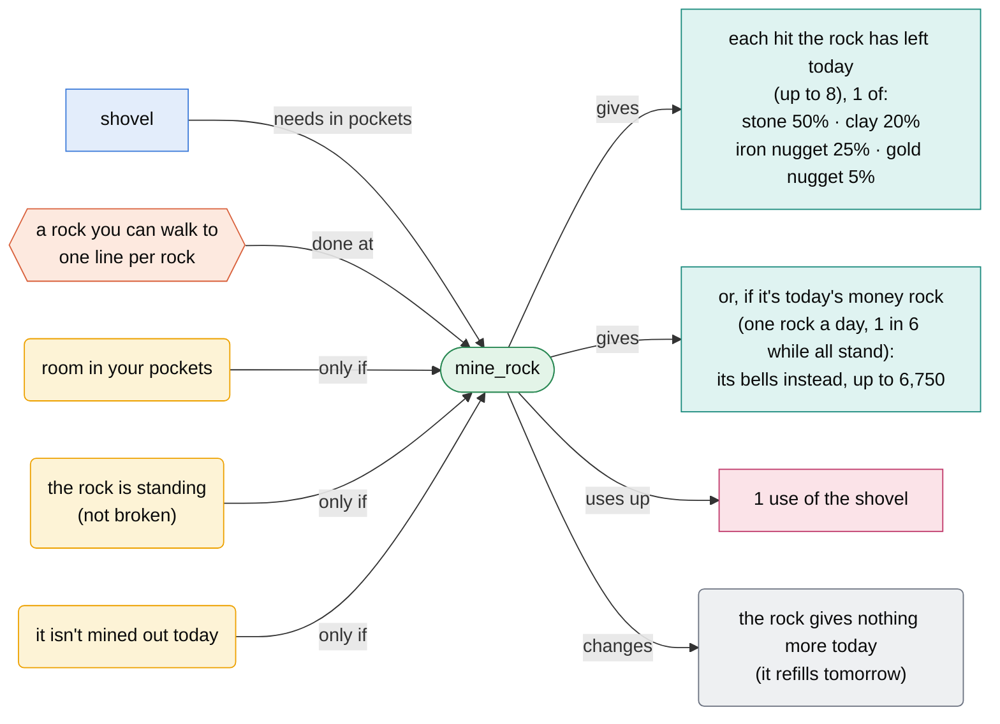

Can still fail when its hour comes: someone mined it out first; pockets full (what doesn't fit stays in the rock).

### 2. `break_rock`

On the list: *break rock 3 (lower ground, centre), eating 1 apple to be strong enough*

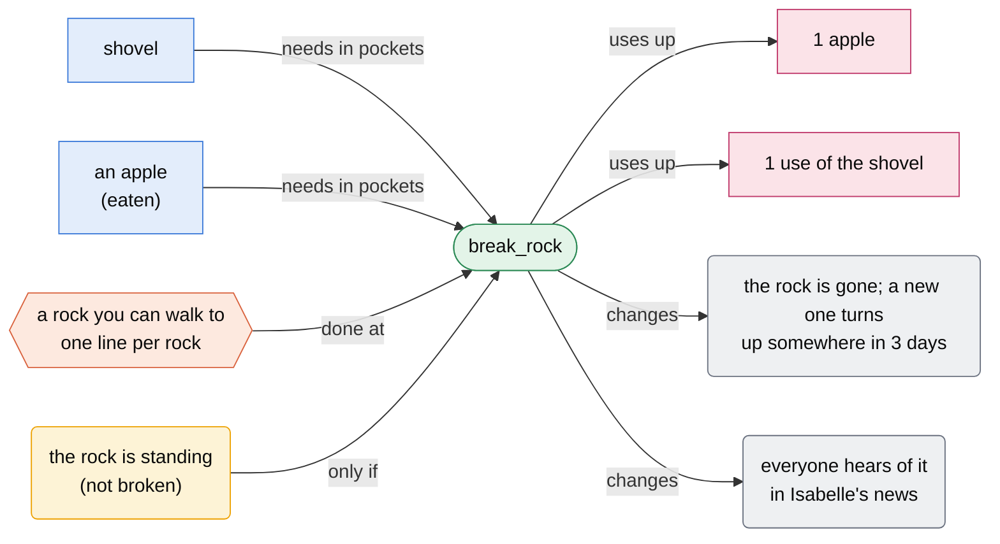

Can still fail when its hour comes: someone broke it first; the apple is gone.

### 3. `chop_wood`

On the list: *chop wood from a hardwood tree with the axe (the axe brings the tree down when it takes its last wood)*

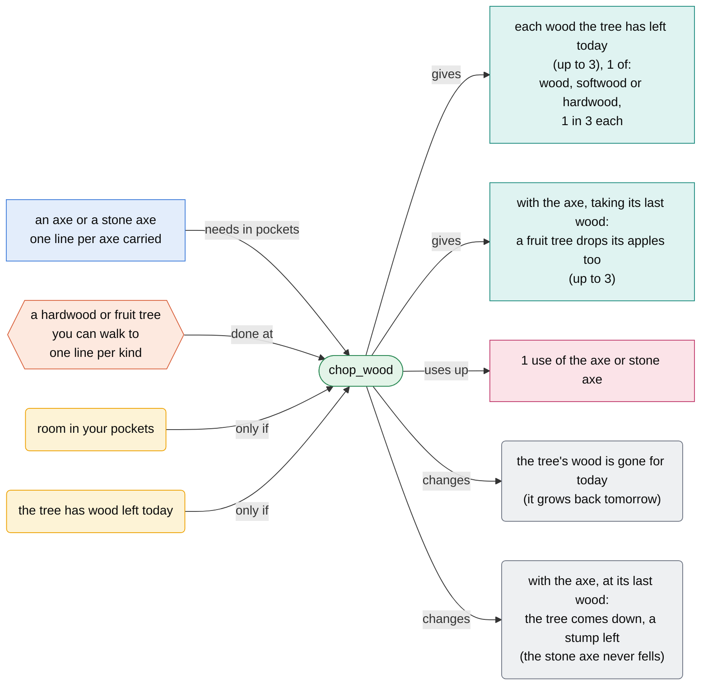

Can still fail when its hour comes: the wood was taken first; pockets full.

### 4. `shake_tree`

On the list: *shake a fruit tree*

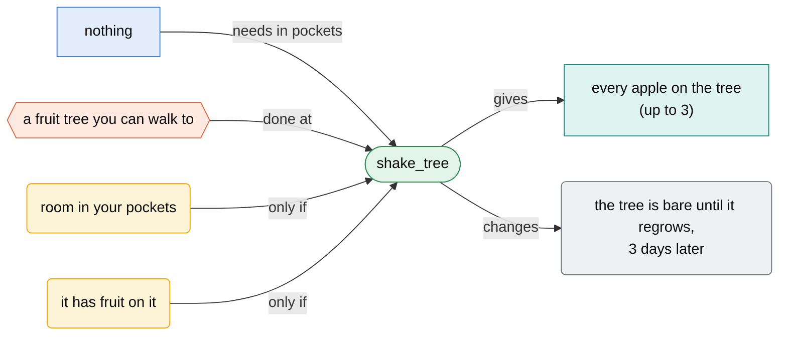

Can still fail when its hour comes: the fruit was taken first; pockets full.

### 5. `fish`

On the list: *fish in the river*

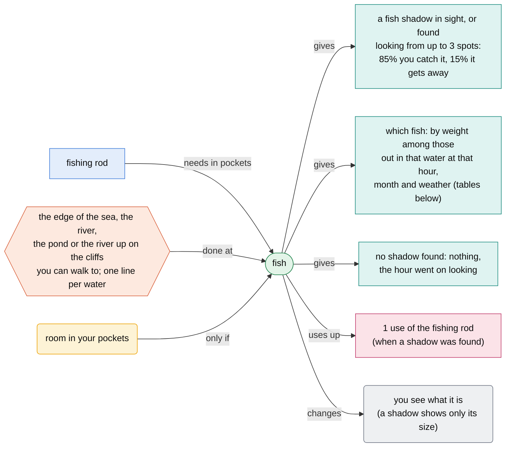

Which fish are out changes hour by hour: only those whose hours, months and weather fit, and a fish you see as a shadow is drawn by weight from those. The chances above are with every one of them out; with fewer out, the rest share the weight.

**The sea**

| fish | weight | chance if all are out | shadow | hours | months | weather |
|---|---|---|---|---|---|---|
| sea bass | 20 | 28% | 5 | all day | all year | any |
| horse mackerel | 15 | 21% | 2 | all day | all year | any |
| anchovy | 12 | 17% | 2 | 04:00-21:00 | all year | any |
| olive flounder | 8 | 11% | 5 | all day | all year | any |
| squid | 8 | 11% | 3 | all day | 12, 1, 2, 3, 4, 5, 6, 7, 8 | any |
| red snapper | 4 | 5.7% | 4 | all day | all year | any |
| barred knifejaw | 2 | 2.8% | 3 | all day | 3, 4, 5, 6, 7, 8, 9, 10, 11 | any |
| tuna | 1 | 1.4% | 6 | all day | 11, 12, 1, 2, 3, 4 | any |
| coelacanth | 0.5 | 0.7% | 6 | all day | all year | wet |

**The river**

| fish | weight | chance if all are out | shadow | hours | months | weather |
|---|---|---|---|---|---|---|
| crucian carp | 15 | 31% | 2 | all day | all year | any |
| dace | 12 | 24% | 3 | 16:00-09:00 | all year | any |
| pale chub | 12 | 24% | 1 | 09:00-16:00 | all year | any |
| black bass | 10 | 20% | 4 | all day | all year | any |

**The pond**

| fish | weight | chance if all are out | shadow | hours | months | weather |
|---|---|---|---|---|---|---|
| carp | 12 | 43% | 4 | all day | all year | any |
| frog | 10 | 36% | 2 | all day | 5, 6, 7, 8 | any |
| goldfish | 4 | 14% | 1 | all day | all year | any |
| koi | 2 | 7.1% | 4 | 16:00-09:00 | all year | any |

**The river up on the cliffs**

| fish | weight | chance if all are out | shadow | hours | months | weather |
|---|---|---|---|---|---|---|
| crucian carp | 15 | 29% | 2 | all day | all year | any |
| dace | 12 | 23% | 3 | 16:00-09:00 | all year | any |
| pale chub | 12 | 23% | 1 | 09:00-16:00 | all year | any |
| black bass | 10 | 19% | 4 | all day | all year | any |
| char | 2 | 3.9% | 3 | 16:00-09:00 | 3, 4, 5, 6, 9, 10, 11 | any |
| golden trout | 0.3 | 0.6% | 3 | 16:00-09:00 | 3, 4, 5, 9, 10, 11 | any |

Can still fail when its hour comes: pockets full; the rod broke.

### 6. `fish (with bait)`

On the list: *fish in the river with fishing bait (uses 1; you carry 2)*

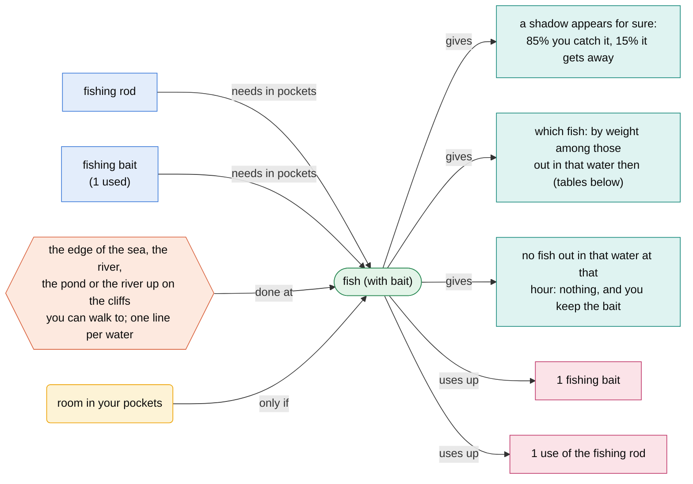

Can still fail when its hour comes: pockets full; the rod broke (with the bait gone, they fish without it and are told so).

### 7. `catch_bug`

On the list: *catch bugs among the flowers*

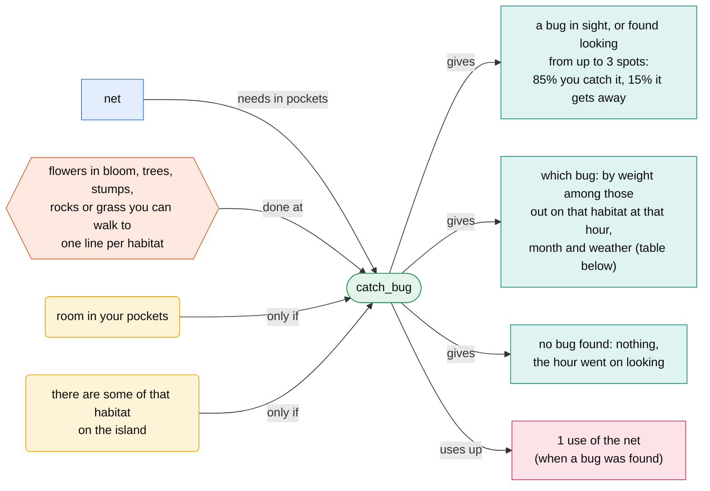

Only bugs whose hours, months and weather fit are out; the chances above are with all of them out.

**On flowers**

| bug | weight | chance if all are out | hours | months | weather |
|---|---|---|---|---|---|
| common butterfly | 15 | 26% | 04:00-19:00 | 9, 10, 11, 12, 1, 2, 3, 4, 5, 6 | dry |
| yellow butterfly | 12 | 21% | 04:00-19:00 | 3, 4, 5, 6, 9, 10 | dry |
| honeybee | 10 | 17% | 08:00-17:00 | 3, 4, 5, 6, 7 | dry |
| ladybug | 10 | 17% | 08:00-17:00 | 3, 4, 5, 6, 10 | dry |
| mantis | 6 | 10% | 08:00-17:00 | 3, 4, 5, 6, 7, 8, 9, 10, 11 | dry |
| peacock butterfly | 2 | 3.4% | 04:00-19:00 | 3, 4, 5, 6 | dry |
| orchid mantis | 2 | 3.4% | 08:00-17:00 | 3, 4, 5, 6, 7, 8, 9, 10, 11 | dry |
| emperor butterfly | 1 | 1.7% | 17:00-08:00 | 12, 1, 2, 3, 6, 7, 8, 9 | dry |

**On trees**

| bug | weight | chance if all are out | hours | months | weather |
|---|---|---|---|---|---|
| wasp | 3 | 57% | all day | all year | any |
| stag beetle | 2 | 38% | all day | 7, 8 | any |
| golden stag | 0.3 | 5.7% | 17:00-08:00 | 7, 8 | any |

**On stumps**

| bug | weight | chance if all are out | hours | months | weather |
|---|---|---|---|---|---|
| citrus long-horned beetle | 6 | 100% | all day | all year | any |

**On rocks**

| bug | weight | chance if all are out | hours | months | weather |
|---|---|---|---|---|---|
| pill bug | 8 | 50% | 23:00-16:00 | 9, 10, 11, 12, 1, 2, 3, 4, 5, 6 | any |
| snail | 8 | 50% | all day | all year | wet |

**In the grass**

| bug | weight | chance if all are out | hours | months | weather |
|---|---|---|---|---|---|
| grasshopper | 10 | 94% | 08:00-17:00 | 7, 8, 9 | dry |
| tarantula | 0.6 | 5.7% | 19:00-04:00 | 11, 12, 1, 2, 3, 4 | any |

Can still fail when its hour comes: pockets full; the net broke.

### 8. `beachcomb`

On the list: *beachcomb*

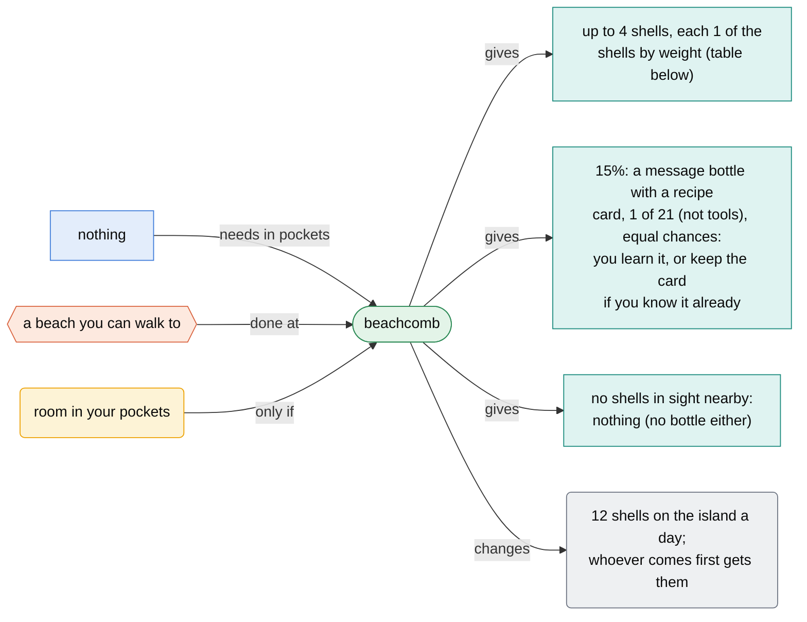

| shell | weight | chance each |
|---|---|---|
| cowrie | 6 | 24% |
| giant clam | 4 | 16% |
| venus comb | 4 | 16% |
| sand dollar | 4 | 16% |
| sea snail | 3 | 12% |
| scallop | 2 | 8% |
| coral | 1 | 4% |
| conch | 1 | 4% |

Can't fail when its hour comes: a picked-clean beach is still an hour on the beach.

### 9. `dig_fossil`

On the list: *dig for fossils*

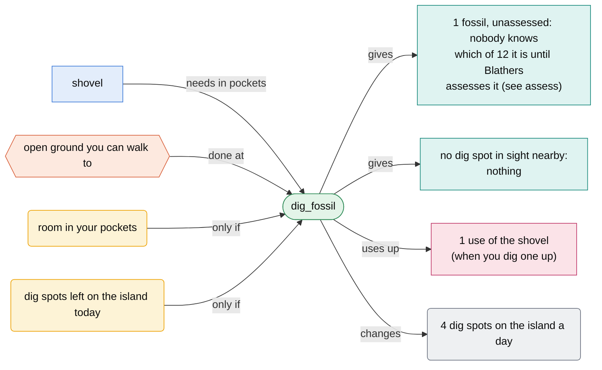

Can still fail when its hour comes: the last spots were dug first; pockets full.

### 10. `dig_clam`

On the list: *dig for manila clams on the beach*

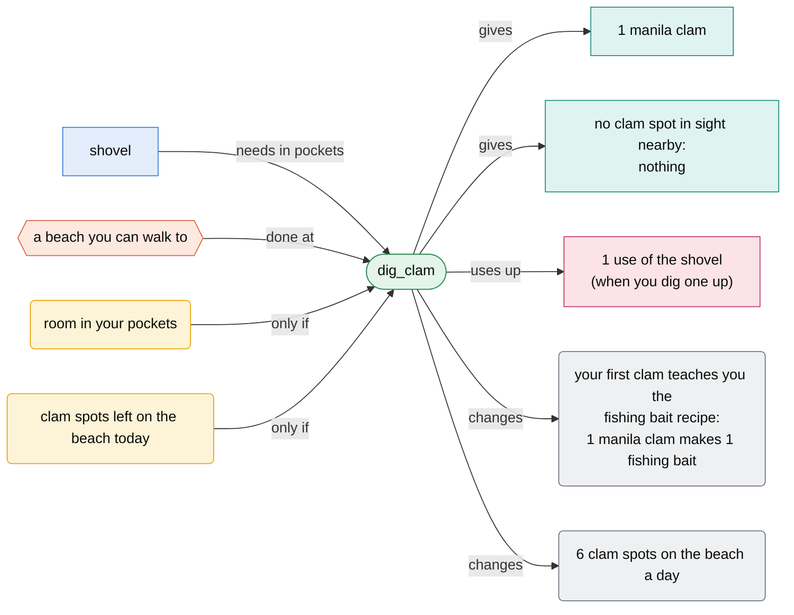

Can still fail when its hour comes: the last spots were dug first; pockets full.

### 11. `dig_stump`

On the list: *dig up a stump*

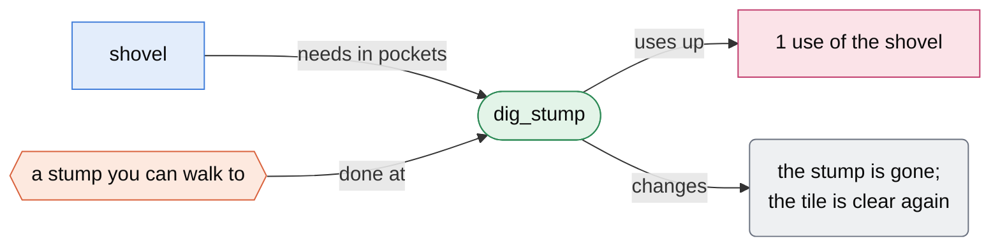

Can still fail when its hour comes: someone dug it up first.

## Bridges and stairs (from prompt version 17)

### 12. `propose_bridge`

On the list: *propose a bridge across the river, at the nearest spot within 8 steps of where you are then (built once 98000 bells are donated at Resident Services; 2 of 10 on the island so far)*

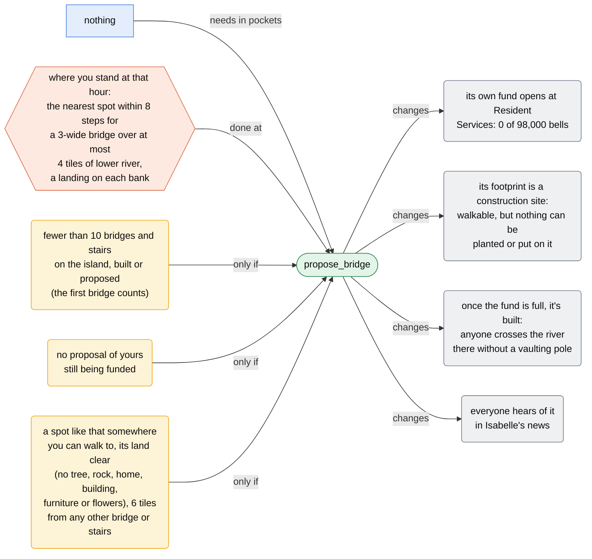

Can still fail when its hour comes: there's no such spot within 8 steps of where you are then (it says where the nearest is).

### 13. `propose_stairs`

On the list: *propose stairs up a cliff, at the nearest spot within 8 steps of where you are then (built once 98000 bells are donated at Resident Services; 2 of 10 on the island so far)*

```mermaid
flowchart LR
    classDef act fill:#e3f4e8,stroke:#2e8b57,color:#0b0b0b
    classDef item fill:#e3edfb,stroke:#3d7bd9,color:#0b0b0b
    classDef place fill:#fde9df,stroke:#d9623d,color:#0b0b0b
    classDef cond fill:#fdf3d6,stroke:#eda100,color:#0b0b0b
    classDef gain fill:#dff3f1,stroke:#1a8a7d,color:#0b0b0b
    classDef spend fill:#fbe3e8,stroke:#c0396b,color:#0b0b0b
    classDef change fill:#eef0f2,stroke:#6b7280,color:#0b0b0b
    A(["propose_stairs"])
    It0["nothing"] -- "needs in pockets" --> A
    Pl0{{"where you stand at that hour:<br/>the nearest spot within 8 steps for<br/>stairs 2 wide and 4 long, two rows<br/>below a cliff edge and two above"}} -- "done at" --> A
    Co0("fewer than 10 bridges and stairs<br/>on the island, built or proposed<br/>(the first bridge counts)") -- "only if" --> A
    Co1("no proposal of yours<br/>still being funded") -- "only if" --> A
    Co2("a spot like that somewhere<br/>you can walk to, its land clear<br/>(no tree, rock, home, building,<br/>furniture or flowers), 6 tiles<br/>from any other bridge or stairs") -- "only if" --> A
    A -- "changes" --> Ch0("its own fund opens at Resident<br/>Services: 0 of 98,000 bells")
    A -- "changes" --> Ch1("its footprint is a construction site:<br/>walkable, but nothing can be<br/>planted or put on it")
    A -- "changes" --> Ch2("once the fund is full, it's built:<br/>anyone climbs that cliff<br/>there without a ladder")
    A -- "changes" --> Ch3("everyone hears of it<br/>in Isabelle's news")
    class A act
    class It0 item
    class Pl0 place
    class Co0,Co1,Co2 cond
    class Ch0,Ch1,Ch2,Ch3 change
```

Can still fail when its hour comes: there's no such spot within 8 steps of where you are then (it says where the nearest is).

## Outside

### 14. `plant`

On the list: *plant an apple (you carry 3); add "near": a place*

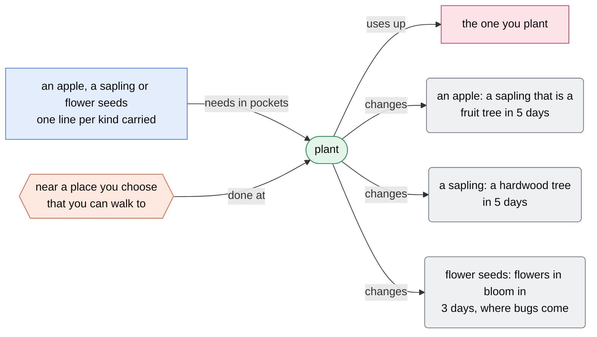

Can still fail when its hour comes: no free spot near there.

### 15. `place`

On the list: *put the log stool outside (you carry 1); add "near": a place*

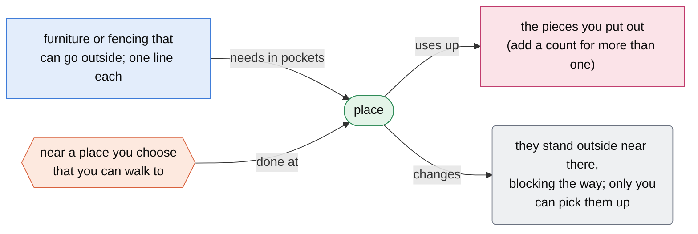

Can still fail when its hour comes: no free space near there.

### 16. `fence_off`

On the list: *fence off around your home with simple wooden fence (you carry 5; one piece per tile)*

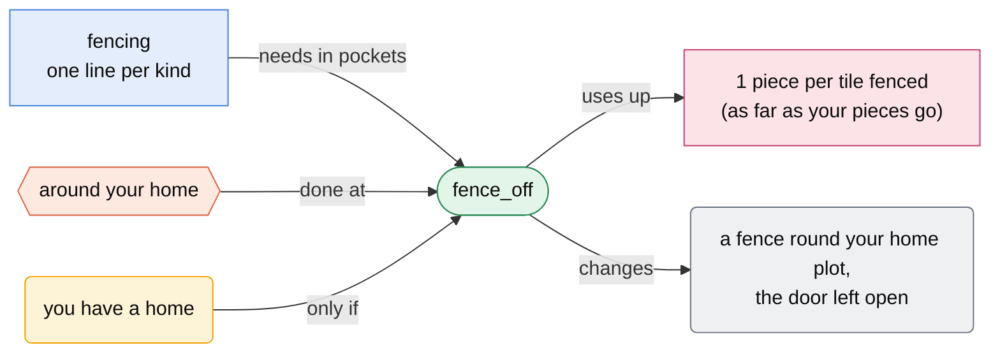

Can still fail when its hour comes: nothing left to fence there.

### 17. `pick_up`

On the list: *pick up log stool you put outside (lower ground, centre) (1 out)*

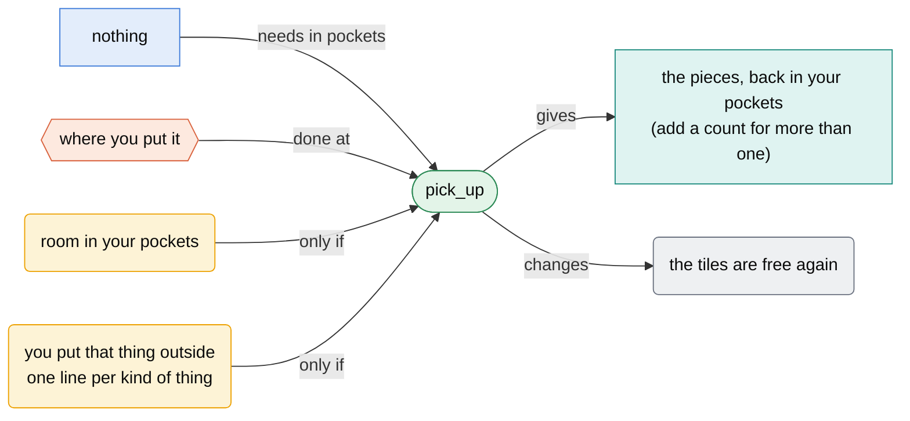

Can still fail when its hour comes: pockets full.

### 18. `lay_path`

On the list: *lay a path; add "style", "from" and "to"*

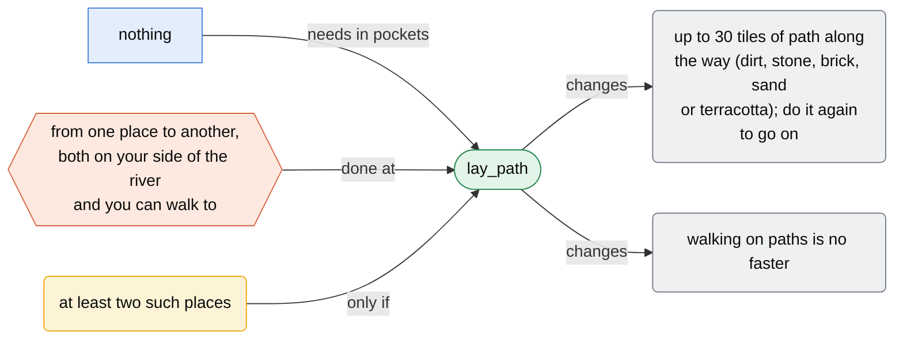

Can still fail when its hour comes: that stretch is already paved.

### 19. `remove_path`

On the list: *take up path tiles you laid around lower ground, centre*

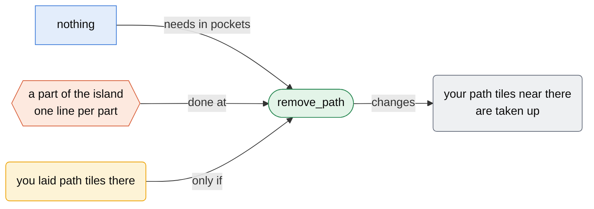

Can still fail when its hour comes: they were taken up already.

## At home, and clothes

### 20. `craft`

On the list: *craft a log stool at home*

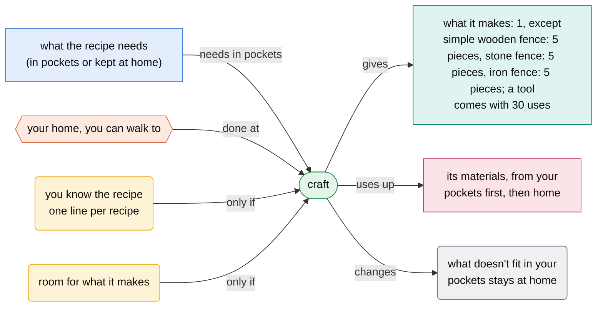

Can still fail when its hour comes: materials used or given away since; pockets full.

### 21. `decorate`

On the list: *put a log stool inside your home*

```mermaid
flowchart LR
    classDef act fill:#e3f4e8,stroke:#2e8b57,color:#0b0b0b
    classDef item fill:#e3edfb,stroke:#3d7bd9,color:#0b0b0b
    classDef place fill:#fde9df,stroke:#d9623d,color:#0b0b0b
    classDef cond fill:#fdf3d6,stroke:#eda100,color:#0b0b0b
    classDef gain fill:#dff3f1,stroke:#1a8a7d,color:#0b0b0b
    classDef spend fill:#fbe3e8,stroke:#c0396b,color:#0b0b0b
    classDef change fill:#eef0f2,stroke:#6b7280,color:#0b0b0b
    A(["decorate"])
    It0["the furniture<br/>one line per piece"] -- "needs in pockets" --> A
    Pl0{{"your home, you can walk to"}} -- "done at" --> A
    Co0("room inside your house") -- "only if" --> A
    A -- "uses up" --> Sp0["the piece, from your pockets"]
    A -- "changes" --> Ch0("it stands inside your home;<br/>visitors see it")
    class A act
    class It0 item
    class Pl0 place
    class Co0 cond
    class Sp0 spend
    class Ch0 change
```

Can still fail when its hour comes: it was given away or put outside since.

### 22. `undecorate`

On the list: *take the log stool out of your home*

```mermaid
flowchart LR
    classDef act fill:#e3f4e8,stroke:#2e8b57,color:#0b0b0b
    classDef item fill:#e3edfb,stroke:#3d7bd9,color:#0b0b0b
    classDef place fill:#fde9df,stroke:#d9623d,color:#0b0b0b
    classDef cond fill:#fdf3d6,stroke:#eda100,color:#0b0b0b
    classDef gain fill:#dff3f1,stroke:#1a8a7d,color:#0b0b0b
    classDef spend fill:#fbe3e8,stroke:#c0396b,color:#0b0b0b
    classDef change fill:#eef0f2,stroke:#6b7280,color:#0b0b0b
    A(["undecorate"])
    It0["nothing"] -- "needs in pockets" --> A
    Pl0{{"your home, you can walk to"}} -- "done at" --> A
    Co0("room in your pockets") -- "only if" --> A
    Co1("it is inside your home<br/>one line per piece") -- "only if" --> A
    A -- "gives" --> Ga0["the piece, back in your pockets"]
    class A act
    class It0 item
    class Pl0 place
    class Co0,Co1 cond
    class Ga0 gain
```

Can still fail when its hour comes: pockets full.

### 23. `wear`

On the list: *put on the straw hat*

```mermaid
flowchart LR
    classDef act fill:#e3f4e8,stroke:#2e8b57,color:#0b0b0b
    classDef item fill:#e3edfb,stroke:#3d7bd9,color:#0b0b0b
    classDef place fill:#fde9df,stroke:#d9623d,color:#0b0b0b
    classDef cond fill:#fdf3d6,stroke:#eda100,color:#0b0b0b
    classDef gain fill:#dff3f1,stroke:#1a8a7d,color:#0b0b0b
    classDef spend fill:#fbe3e8,stroke:#c0396b,color:#0b0b0b
    classDef change fill:#eef0f2,stroke:#6b7280,color:#0b0b0b
    A(["wear"])
    It0["the clothing<br/>one line per piece"] -- "needs in pockets" --> A
    Pl0{{"wherever you are"}} -- "done at" --> A
    A -- "changes" --> Ch0("you wear it, and others see it")
    A -- "changes" --> Ch1("what you wore in that slot<br/>goes back to your pockets")
    class A act
    class It0 item
    class Pl0 place
    class Ch0,Ch1 change
```

Can still fail when its hour comes: it was given away since.

## Visiting

### 24. `visit`

On the list: *visit Jo at their home (lower ground, west)*

```mermaid
flowchart LR
    classDef act fill:#e3f4e8,stroke:#2e8b57,color:#0b0b0b
    classDef item fill:#e3edfb,stroke:#3d7bd9,color:#0b0b0b
    classDef place fill:#fde9df,stroke:#d9623d,color:#0b0b0b
    classDef cond fill:#fdf3d6,stroke:#eda100,color:#0b0b0b
    classDef gain fill:#dff3f1,stroke:#1a8a7d,color:#0b0b0b
    classDef spend fill:#fbe3e8,stroke:#c0396b,color:#0b0b0b
    classDef change fill:#eef0f2,stroke:#6b7280,color:#0b0b0b
    A(["visit"])
    It0["nothing"] -- "needs in pockets" --> A
    Pl0{{"the other villager's home<br/>you can walk to; one line per villager"}} -- "done at" --> A
    Co0("they have a home") -- "only if" --> A
    A -- "changes" --> Ch0("they're home, awake and free: they<br/>let you in, you see what's inside,<br/>and you can talk (gifts, requests,<br/>trades), free of any action")
    A -- "changes" --> Ch1("nobody answers: they hear<br/>later that you came by")
    class A act
    class It0 item
    class Pl0 place
    class Co0 cond
    class Ch0,Ch1 change
```

Can't fail when its hour comes.

## Shops and services

### 25. `ask`

On the list: *ask Tom Nook what they do and what it costs (at Resident Services)*

```mermaid
flowchart LR
    classDef act fill:#e3f4e8,stroke:#2e8b57,color:#0b0b0b
    classDef item fill:#e3edfb,stroke:#3d7bd9,color:#0b0b0b
    classDef place fill:#fde9df,stroke:#d9623d,color:#0b0b0b
    classDef cond fill:#fdf3d6,stroke:#eda100,color:#0b0b0b
    classDef gain fill:#dff3f1,stroke:#1a8a7d,color:#0b0b0b
    classDef spend fill:#fbe3e8,stroke:#c0396b,color:#0b0b0b
    classDef change fill:#eef0f2,stroke:#6b7280,color:#0b0b0b
    A(["ask"])
    It0["nothing"] -- "needs in pockets" --> A
    Pl0{{"Resident Services (Tom Nook, Isabelle),<br/>the museum (Blathers), Nook's Cranny<br/>(Timmy and Tommy) or the Able Sisters<br/>you can walk to; one line per person"}} -- "done at" --> A
    Co0("it's open during the plan<br/>Nook's Cranny 08:00-22:00,<br/>Able Sisters 09:00-21:00,<br/>the others all day") -- "only if" --> A
    A -- "gives" --> Ga0["Tom Nook or Isabelle, when you<br/>carry no map and have room:<br/>an island map"]
    A -- "changes" --> Ch0("you hear what they do and what<br/>it costs (houses, moves, bridges<br/>and stairs; ordinances; the museum;<br/>prices; clothes)")
    A -- "changes" --> Ch1("Timmy and Tommy: what they'd pay<br/>for what you carry joins the<br/>prices you've heard")
    class A act
    class It0 item
    class Pl0 place
    class Co0 cond
    class Ga0 gain
    class Ch0,Ch1 change
```

Can't fail when its hour comes.

### 26. `sell`

On the list: *sell at Nook's Cranny; add "items": what and how many*

```mermaid
flowchart LR
    classDef act fill:#e3f4e8,stroke:#2e8b57,color:#0b0b0b
    classDef item fill:#e3edfb,stroke:#3d7bd9,color:#0b0b0b
    classDef place fill:#fde9df,stroke:#d9623d,color:#0b0b0b
    classDef cond fill:#fdf3d6,stroke:#eda100,color:#0b0b0b
    classDef gain fill:#dff3f1,stroke:#1a8a7d,color:#0b0b0b
    classDef spend fill:#fbe3e8,stroke:#c0396b,color:#0b0b0b
    classDef change fill:#eef0f2,stroke:#6b7280,color:#0b0b0b
    A(["sell"])
    It0["things Timmy and Tommy buy"] -- "needs in pockets" --> A
    Pl0{{"Nook's Cranny, you can walk to"}} -- "done at" --> A
    Co0("open during the plan<br/>08:00-22:00") -- "only if" --> A
    A -- "gives" --> Ga0["bells: each thing's Cranny price<br/>(more under Bell Boom)"]
    A -- "uses up" --> Sp0["the things sold"]
    A -- "changes" --> Ch0("their prices join the<br/>prices you've heard")
    class A act
    class It0 item
    class Pl0 place
    class Co0 cond
    class Ga0 gain
    class Sp0 spend
    class Ch0 change
```

Can still fail when its hour comes: none of it is in your pockets any more.

### 27. `buy (a thing)`

On the list: *buy fishing bait at Nook's Cranny, 300 bells each; add "count"*

```mermaid
flowchart LR
    classDef act fill:#e3f4e8,stroke:#2e8b57,color:#0b0b0b
    classDef item fill:#e3edfb,stroke:#3d7bd9,color:#0b0b0b
    classDef place fill:#fde9df,stroke:#d9623d,color:#0b0b0b
    classDef cond fill:#fdf3d6,stroke:#eda100,color:#0b0b0b
    classDef gain fill:#dff3f1,stroke:#1a8a7d,color:#0b0b0b
    classDef spend fill:#fbe3e8,stroke:#c0396b,color:#0b0b0b
    classDef change fill:#eef0f2,stroke:#6b7280,color:#0b0b0b
    A(["buy (a thing)"])
    It0["bells for one<br/>(in your wallet)"] -- "needs in pockets" --> A
    Pl0{{"Nook's Cranny, you can walk to"}} -- "done at" --> A
    Co0("open during the plan<br/>08:00-22:00") -- "only if" --> A
    Co1("it's in today's stock<br/>one line per thing") -- "only if" --> A
    Co2("room in your pockets") -- "only if" --> A
    A -- "gives" --> Ga0["the thing; up to 10 at once,<br/>as many as you can pay<br/>for and carry"]
    A -- "uses up" --> Sp0["its price in bells, each"]
    class A act
    class It0 item
    class Pl0 place
    class Co0,Co1,Co2 cond
    class Ga0 gain
    class Sp0 spend
```

Can still fail when its hour comes: bells spent since; pockets full.

### 28. `buy (a tool)`

On the list: *buy a new shovel at Nook's Cranny, 800 bells each*

```mermaid
flowchart LR
    classDef act fill:#e3f4e8,stroke:#2e8b57,color:#0b0b0b
    classDef item fill:#e3edfb,stroke:#3d7bd9,color:#0b0b0b
    classDef place fill:#fde9df,stroke:#d9623d,color:#0b0b0b
    classDef cond fill:#fdf3d6,stroke:#eda100,color:#0b0b0b
    classDef gain fill:#dff3f1,stroke:#1a8a7d,color:#0b0b0b
    classDef spend fill:#fbe3e8,stroke:#c0396b,color:#0b0b0b
    classDef change fill:#eef0f2,stroke:#6b7280,color:#0b0b0b
    A(["buy (a tool)"])
    It0["bells for one<br/>(in your wallet)"] -- "needs in pockets" --> A
    Pl0{{"Nook's Cranny, you can walk to"}} -- "done at" --> A
    Co0("open during the plan<br/>08:00-22:00") -- "only if" --> A
    Co1("one line per tool<br/>(always in stock)") -- "only if" --> A
    Co2("room in your pockets") -- "only if" --> A
    A -- "gives" --> Ga0["a new tool with 30 uses"]
    A -- "uses up" --> Sp0["its price in bells, each"]
    class A act
    class It0 item
    class Pl0 place
    class Co0,Co1,Co2 cond
    class Ga0 gain
    class Sp0 spend
```

Can still fail when its hour comes: bells spent since; pockets full.

### 29. `buy (a recipe card)`

On the list: *buy the shovel recipe card at Nook's Cranny, 200 bells*

```mermaid
flowchart LR
    classDef act fill:#e3f4e8,stroke:#2e8b57,color:#0b0b0b
    classDef item fill:#e3edfb,stroke:#3d7bd9,color:#0b0b0b
    classDef place fill:#fde9df,stroke:#d9623d,color:#0b0b0b
    classDef cond fill:#fdf3d6,stroke:#eda100,color:#0b0b0b
    classDef gain fill:#dff3f1,stroke:#1a8a7d,color:#0b0b0b
    classDef spend fill:#fbe3e8,stroke:#c0396b,color:#0b0b0b
    classDef change fill:#eef0f2,stroke:#6b7280,color:#0b0b0b
    A(["buy (a recipe card)"])
    It0["bells for it<br/>(in your wallet)"] -- "needs in pockets" --> A
    Pl0{{"Nook's Cranny, you can walk to"}} -- "done at" --> A
    Co0("open during the plan<br/>08:00-22:00") -- "only if" --> A
    Co1("it's for sale today<br/>(tool cards always, plus one)") -- "only if" --> A
    Co2("room in your pockets,<br/>only if you already know it") -- "only if" --> A
    A -- "gives" --> Ga0["a card for a recipe you<br/>already know: the card"]
    A -- "uses up" --> Sp0["its price in bells"]
    A -- "changes" --> Ch0("you learn the recipe, and<br/>what it needs")
    class A act
    class It0 item
    class Pl0 place
    class Co0,Co1,Co2 cond
    class Ga0 gain
    class Sp0 spend
    class Ch0 change
```

Can still fail when its hour comes: bells spent since.

### 30. `buy (clothes)`

On the list: *buy the kimono at the Able Sisters, 4800 bells*

```mermaid
flowchart LR
    classDef act fill:#e3f4e8,stroke:#2e8b57,color:#0b0b0b
    classDef item fill:#e3edfb,stroke:#3d7bd9,color:#0b0b0b
    classDef place fill:#fde9df,stroke:#d9623d,color:#0b0b0b
    classDef cond fill:#fdf3d6,stroke:#eda100,color:#0b0b0b
    classDef gain fill:#dff3f1,stroke:#1a8a7d,color:#0b0b0b
    classDef spend fill:#fbe3e8,stroke:#c0396b,color:#0b0b0b
    classDef change fill:#eef0f2,stroke:#6b7280,color:#0b0b0b
    A(["buy (clothes)"])
    It0["bells for it<br/>(in your wallet)"] -- "needs in pockets" --> A
    Pl0{{"the Able Sisters, you can walk to"}} -- "done at" --> A
    Co0("open during the plan<br/>09:00-21:00") -- "only if" --> A
    Co1("it's in today's stock<br/>one line per piece") -- "only if" --> A
    Co2("room in your pockets") -- "only if" --> A
    A -- "gives" --> Ga0["the piece of clothing"]
    A -- "uses up" --> Sp0["its price in bells"]
    class A act
    class It0 item
    class Pl0 place
    class Co0,Co1,Co2 cond
    class Ga0 gain
    class Sp0 spend
```

Can still fail when its hour comes: bells spent since; pockets full.

### 31. `assess`

On the list: *have Blathers assess your fossils (1) at the museum*

```mermaid
flowchart LR
    classDef act fill:#e3f4e8,stroke:#2e8b57,color:#0b0b0b
    classDef item fill:#e3edfb,stroke:#3d7bd9,color:#0b0b0b
    classDef place fill:#fde9df,stroke:#d9623d,color:#0b0b0b
    classDef cond fill:#fdf3d6,stroke:#eda100,color:#0b0b0b
    classDef gain fill:#dff3f1,stroke:#1a8a7d,color:#0b0b0b
    classDef spend fill:#fbe3e8,stroke:#c0396b,color:#0b0b0b
    classDef change fill:#eef0f2,stroke:#6b7280,color:#0b0b0b
    A(["assess"])
    It0["an unassessed fossil"] -- "needs in pockets" --> A
    Pl0{{"the museum, you can walk to"}} -- "done at" --> A
    Co0("open (all day)") -- "only if" --> A
    A -- "gives" --> Ga0["each becomes 1 of 12 fossils,<br/>equal chances (table below)"]
    A -- "uses up" --> Sp0["every unassessed fossil<br/>you carry"]
    A -- "changes" --> Ch0("now the museum takes them, and<br/>the Cranny pays 1,000 to 6,000")
    class A act
    class It0 item
    class Pl0 place
    class Co0 cond
    class Ga0 gain
    class Sp0 spend
    class Ch0 change
```

Each of these equally likely (1 in 12): amber, ammonite, ankylo skull, archaeopteryx, coprolite, dinosaur track, dunkleosteus, ptera body, shark-tooth pattern, stego skull, t. rex skull, trilobite.

Can still fail when its hour comes: the fossils are gone from your pockets.

### 32. `donate`

On the list: *donate a sea bass at the museum*

```mermaid
flowchart LR
    classDef act fill:#e3f4e8,stroke:#2e8b57,color:#0b0b0b
    classDef item fill:#e3edfb,stroke:#3d7bd9,color:#0b0b0b
    classDef place fill:#fde9df,stroke:#d9623d,color:#0b0b0b
    classDef cond fill:#fdf3d6,stroke:#eda100,color:#0b0b0b
    classDef gain fill:#dff3f1,stroke:#1a8a7d,color:#0b0b0b
    classDef spend fill:#fbe3e8,stroke:#c0396b,color:#0b0b0b
    classDef change fill:#eef0f2,stroke:#6b7280,color:#0b0b0b
    A(["donate"])
    It0["a fish, bug or assessed fossil<br/>one line per kind"] -- "needs in pockets" --> A
    Pl0{{"the museum, you can walk to"}} -- "done at" --> A
    Co0("open (all day)") -- "only if" --> A
    Co1("the museum doesn't have one yet") -- "only if" --> A
    A -- "gives" --> Ga0["no bells"]
    A -- "uses up" --> Sp0["the one you donate"]
    A -- "changes" --> Ch0("the museum has it, with your<br/>name, for everyone to see")
    A -- "changes" --> Ch1("everyone hears of it<br/>in Isabelle's news")
    class A act
    class It0 item
    class Pl0 place
    class Co0,Co1 cond
    class Ga0 gain
    class Sp0 spend
    class Ch0,Ch1 change
```

Can still fail when its hour comes: someone donated one first; it's gone from your pockets.

### 33. `upgrade_house`

On the list: *have Tom Nook upgrade your tent at Resident Services*

```mermaid
flowchart LR
    classDef act fill:#e3f4e8,stroke:#2e8b57,color:#0b0b0b
    classDef item fill:#e3edfb,stroke:#3d7bd9,color:#0b0b0b
    classDef place fill:#fde9df,stroke:#d9623d,color:#0b0b0b
    classDef cond fill:#fdf3d6,stroke:#eda100,color:#0b0b0b
    classDef gain fill:#dff3f1,stroke:#1a8a7d,color:#0b0b0b
    classDef spend fill:#fbe3e8,stroke:#c0396b,color:#0b0b0b
    classDef change fill:#eef0f2,stroke:#6b7280,color:#0b0b0b
    A(["upgrade_house"])
    It0["nothing"] -- "needs in pockets" --> A
    Pl0{{"Resident Services, you can walk to"}} -- "done at" --> A
    Co0("open (all day)") -- "only if" --> A
    Co1("no loan owed") -- "only if" --> A
    Co2("a bigger house to go to") -- "only if" --> A
    A -- "changes" --> Ch0("the next house, right away:<br/>more storage and room inside<br/>(table below)")
    A -- "changes" --> Ch1("a loan for its cost<br/>(no interest, no deadline);<br/>paid off before the next one")
    class A act
    class It0 item
    class Pl0 place
    class Co0,Co1,Co2 cond
    class Ch0,Ch1 change
```

| house | loan (bells) | storage at home | furniture inside |
|---|---|---|---|
| tent | 0 | 0 | 6 |
| house | 98,000 | 80 | 12 |
| bigger house | 198,000 | 120 | 18 |
| house with back room | 348,000 | 240 | 30 |
| two-story house | 548,000 | 320 | 40 |

Can't fail when its hour comes.

### 34. `pay_loan`

On the list: *pay Tom Nook toward your loan (you owe 98000) at Resident Services; add "bells"*

```mermaid
flowchart LR
    classDef act fill:#e3f4e8,stroke:#2e8b57,color:#0b0b0b
    classDef item fill:#e3edfb,stroke:#3d7bd9,color:#0b0b0b
    classDef place fill:#fde9df,stroke:#d9623d,color:#0b0b0b
    classDef cond fill:#fdf3d6,stroke:#eda100,color:#0b0b0b
    classDef gain fill:#dff3f1,stroke:#1a8a7d,color:#0b0b0b
    classDef spend fill:#fbe3e8,stroke:#c0396b,color:#0b0b0b
    classDef change fill:#eef0f2,stroke:#6b7280,color:#0b0b0b
    A(["pay_loan"])
    It0["bells<br/>(in your wallet)"] -- "needs in pockets" --> A
    Pl0{{"Resident Services, you can walk to"}} -- "done at" --> A
    Co0("open (all day)") -- "only if" --> A
    Co1("a loan owed") -- "only if" --> A
    A -- "uses up" --> Sp0["the bells you pay<br/>(up to what you owe)"]
    A -- "changes" --> Ch0("the loan goes down; at 0<br/>you can upgrade again")
    class A act
    class It0 item
    class Pl0 place
    class Co0,Co1 cond
    class Sp0 spend
    class Ch0 change
```

Can still fail when its hour comes: the wallet is empty by then.

### 35. `contribute_bridge`

On the list: *put bells toward the stairs up to the middle cliff (north) (0/98000 raised, Ari's proposal) at Resident Services; add "bells"*

```mermaid
flowchart LR
    classDef act fill:#e3f4e8,stroke:#2e8b57,color:#0b0b0b
    classDef item fill:#e3edfb,stroke:#3d7bd9,color:#0b0b0b
    classDef place fill:#fde9df,stroke:#d9623d,color:#0b0b0b
    classDef cond fill:#fdf3d6,stroke:#eda100,color:#0b0b0b
    classDef gain fill:#dff3f1,stroke:#1a8a7d,color:#0b0b0b
    classDef spend fill:#fbe3e8,stroke:#c0396b,color:#0b0b0b
    classDef change fill:#eef0f2,stroke:#6b7280,color:#0b0b0b
    A(["contribute_bridge"])
    It0["bells<br/>(in your wallet)"] -- "needs in pockets" --> A
    Pl0{{"Resident Services, you can walk to"}} -- "done at" --> A
    Co0("open (all day)") -- "only if" --> A
    Co1("that bridge or stairs isn't built yet<br/>one line per fund: the first bridge<br/>and each proposal (version 17)") -- "only if" --> A
    A -- "uses up" --> Sp0["the bells you put in<br/>(up to what the fund still needs)"]
    A -- "changes" --> Ch0("that fund goes up; at 98,000<br/>it's built at once: a crossing,<br/>or stairs")
    A -- "changes" --> Ch1("everyone hears of a finished one<br/>in Isabelle's news")
    class A act
    class It0 item
    class Pl0 place
    class Co0,Co1 cond
    class Sp0 spend
    class Ch0,Ch1 change
```

Can still fail when its hour comes: the wallet is empty by then; someone else finished the fund first.

### 36. `set_ordinance`

On the list: *pay Isabelle 20000 bells to set the bell boom ordinance from tomorrow at Resident Services*

```mermaid
flowchart LR
    classDef act fill:#e3f4e8,stroke:#2e8b57,color:#0b0b0b
    classDef item fill:#e3edfb,stroke:#3d7bd9,color:#0b0b0b
    classDef place fill:#fde9df,stroke:#d9623d,color:#0b0b0b
    classDef cond fill:#fdf3d6,stroke:#eda100,color:#0b0b0b
    classDef gain fill:#dff3f1,stroke:#1a8a7d,color:#0b0b0b
    classDef spend fill:#fbe3e8,stroke:#c0396b,color:#0b0b0b
    classDef change fill:#eef0f2,stroke:#6b7280,color:#0b0b0b
    A(["set_ordinance"])
    It0["20,000 bells<br/>(in your wallet)"] -- "needs in pockets" --> A
    Pl0{{"Resident Services, you can walk to"}} -- "done at" --> A
    Co0("open (all day)") -- "only if" --> A
    Co1("that ordinance isn't in effect<br/>one line per ordinance") -- "only if" --> A
    A -- "uses up" --> Sp0["20,000 bells"]
    A -- "changes" --> Ch0("from tomorrow morning, for<br/>everyone (table below)")
    A -- "changes" --> Ch1("everyone hears of it<br/>in Isabelle's news")
    class A act
    class It0 item
    class Pl0 place
    class Co0,Co1 cond
    class Sp0 spend
    class Ch0,Ch1 change
```

| ordinance | what it does | in the world file |
|---|---|---|
| none | no ordinance |  |
| early bird | everyone keeps earlier hours, and the shops open and close earlier | schedule shift -2, shop shift -2 |
| night owl | everyone keeps later hours, and the shops open and close later | schedule shift +2, shop shift +2 |
| bell boom | Nook's Cranny pays more for everything, and everything in the shops costs more | price factor x1.2 |

Can still fail when its hour comes: bells spent since; someone set it first.

### 37. `move_house`

On the list: *pay Tom Nook 10000 bells to move your home to site-3 (lower ground, east) overnight at Resident Services*

```mermaid
flowchart LR
    classDef act fill:#e3f4e8,stroke:#2e8b57,color:#0b0b0b
    classDef item fill:#e3edfb,stroke:#3d7bd9,color:#0b0b0b
    classDef place fill:#fde9df,stroke:#d9623d,color:#0b0b0b
    classDef cond fill:#fdf3d6,stroke:#eda100,color:#0b0b0b
    classDef gain fill:#dff3f1,stroke:#1a8a7d,color:#0b0b0b
    classDef spend fill:#fbe3e8,stroke:#c0396b,color:#0b0b0b
    classDef change fill:#eef0f2,stroke:#6b7280,color:#0b0b0b
    A(["move_house"])
    It0["10,000 bells<br/>(in your wallet)"] -- "needs in pockets" --> A
    Pl0{{"Resident Services, you can walk to"}} -- "done at" --> A
    Co0("open (all day)") -- "only if" --> A
    Co1("a free homesite<br/>one line per site") -- "only if" --> A
    Co2("no move of yours pending") -- "only if" --> A
    A -- "uses up" --> Sp0["10,000 bells"]
    A -- "changes" --> Ch0("overnight, your home moves there<br/>with everything in it")
    A -- "changes" --> Ch1("everyone hears of it<br/>in Isabelle's news")
    class A act
    class It0 item
    class Pl0 place
    class Co0,Co1,Co2 cond
    class Sp0 spend
    class Ch0,Ch1 change
```

Can still fail when its hour comes: bells spent since; someone took the site first.

## Resting, getting home, the plaza

### 38. `rest`

On the list: *rest*

```mermaid
flowchart LR
    classDef act fill:#e3f4e8,stroke:#2e8b57,color:#0b0b0b
    classDef item fill:#e3edfb,stroke:#3d7bd9,color:#0b0b0b
    classDef place fill:#fde9df,stroke:#d9623d,color:#0b0b0b
    classDef cond fill:#fdf3d6,stroke:#eda100,color:#0b0b0b
    classDef gain fill:#dff3f1,stroke:#1a8a7d,color:#0b0b0b
    classDef spend fill:#fbe3e8,stroke:#c0396b,color:#0b0b0b
    classDef change fill:#eef0f2,stroke:#6b7280,color:#0b0b0b
    A(["rest"])
    It0["nothing"] -- "needs in pockets" --> A
    Pl0{{"your home, or where you are<br/>if you can't get home"}} -- "done at" --> A
    A -- "changes" --> Ch0("nothing: the hour passes")
    class A act
    class It0 item
    class Pl0 place
    class Ch0 change
```

Can't fail when its hour comes.

### 39. `call_rescue`

On the list: *call the Rescue Service to take you home (once a day)*

```mermaid
flowchart LR
    classDef act fill:#e3f4e8,stroke:#2e8b57,color:#0b0b0b
    classDef item fill:#e3edfb,stroke:#3d7bd9,color:#0b0b0b
    classDef place fill:#fde9df,stroke:#d9623d,color:#0b0b0b
    classDef cond fill:#fdf3d6,stroke:#eda100,color:#0b0b0b
    classDef gain fill:#dff3f1,stroke:#1a8a7d,color:#0b0b0b
    classDef spend fill:#fbe3e8,stroke:#c0396b,color:#0b0b0b
    classDef change fill:#eef0f2,stroke:#6b7280,color:#0b0b0b
    A(["call_rescue"])
    It0["nothing"] -- "needs in pockets" --> A
    Pl0{{"where you're stuck"}} -- "done at" --> A
    Co0("you can't get home with<br/>the ladder and pole you carry") -- "only if" --> A
    Co1("it hasn't taken you home yet today") -- "only if" --> A
    A -- "changes" --> Ch0("you're home now, with a talking-to<br/>about why you got stuck")
    A -- "changes" --> Ch1("it won't come again today")
    class A act
    class It0 item
    class Pl0 place
    class Co0,Co1 cond
    class Ch0,Ch1 change
```

Can still fail when its hour comes: you can get home by then after all.

### 40. `plaza`

On the list: *spend the hour at the plaza: the bulletin board, letters and parcels (not one of your actions)*

```mermaid
flowchart LR
    classDef act fill:#e3f4e8,stroke:#2e8b57,color:#0b0b0b
    classDef item fill:#e3edfb,stroke:#3d7bd9,color:#0b0b0b
    classDef place fill:#fde9df,stroke:#d9623d,color:#0b0b0b
    classDef cond fill:#fdf3d6,stroke:#eda100,color:#0b0b0b
    classDef gain fill:#dff3f1,stroke:#1a8a7d,color:#0b0b0b
    classDef spend fill:#fbe3e8,stroke:#c0396b,color:#0b0b0b
    classDef change fill:#eef0f2,stroke:#6b7280,color:#0b0b0b
    A(["plaza"])
    It0["nothing"] -- "needs in pockets" --> A
    Pl0{{"the plaza, you can walk to"}} -- "done at" --> A
    Co0("takes the hour, but isn't<br/>one of the day's actions") -- "only if" --> A
    A -- "changes" --> Ch0("one turn there: read and post on<br/>the board, take your posts down,<br/>send letters and parcels<br/>(they arrive tomorrow)")
    class A act
    class It0 item
    class Pl0 place
    class Co0 cond
    class Ch0 change
```

Can't fail when its hour comes.

## Once picked (the same for every action)

```mermaid
flowchart TD
    classDef llm fill:#e9e3fb,stroke:#6250d6,color:#1b1240
    classDef file fill:#f1f0ec,stroke:#8a8984,color:#0b0b0b
    classDef gate fill:#fdf3d6,stroke:#eda100,color:#0b0b0b

    plan(["LLM: plan<br/>picks numbers for hours, adding a count,<br/>bells or a place where an option takes one"])
    readable{"Number on the list,<br/>value allowed?"}
    told["Dropped; their day says<br/>'in your plan, there is no 7 on your list,<br/>so it wasn't planned'"]
    hourq{"A free hour? awake, actions left<br/>today and in this plan; a shop or<br/>service pick goes in an hour it's open"}
    dropped["Dropped, with why"]
    sched["Scheduled"]
    pl[("events.jsonl: plan")]
    spot{"Went after a bug or fish<br/>spotted the hour before?<br/>version 14"}
    swapped["That catch takes the hour"]
    run["That hour: walk there, do it<br/>see chart 3 in day_flow.md;<br/>fails only as in the charts above"]
    aev[("events.jsonl: action")]

    plan --> readable
    readable -- yes --> hourq
    readable -- no --> told --> pl
    hourq -- yes --> sched --> pl
    hourq -- no --> dropped --> pl
    pl --> spot
    spot -- no --> run --> aev
    spot -- yes --> swapped

    class plan llm
    class pl,aev file
    class readable,hourq,spot gate
```
