# Every action, what it takes and what comes of it

Prompt version 21 on. Each plan lists the actions a villager can do then, one line per kind of
action; this file shows, for every action in the game, what puts it on that list and what comes of
doing it. How plans fit into a day and an hour is in [day_flow.md](day_flow.md); the code is
`options.py` (the list) and `world.py` (what happens). Generated by `scripts/actions_doc.py` from
`data/island_world.yaml`; rerun it after changing the world file or the rules.

Each action is a small graph with the action in the centre, what it takes on the left and what comes
of it on the right. What it takes, on the left:
- **green:** the action
- **blue, "needs in pockets":** what has to be in their pockets when they plan
- **orange, "done at":** where it happens; always somewhere they can walk to with the ladder and
  vaulting pole they carry, from where they are (the way is the same in both directions, so this
  holds wherever the plan takes them)
- **yellow, "only if":** anything else that has to be true when they plan

**A plan's pick has the same parts as the left of a chart.** A villager plans an action by naming
it and what it takes:

    {"hour": 9, "pick": {"action": "sell", "items": {"sea bass": 2}, "at": "Nook's Cranny"}}

| in the pick | in the chart | what it is |
|---|---|---|
| `"action"` | green | the action's name, as in the headings below |
| `"items"` | blue, "needs in pockets" | what it uses from their pockets, as `{"<thing>": <how many>}`; bells from the wallet are `"bells"` |
| `"at"` | orange, "done at" | where: which rock, water, home, person or place |
| `"what"` | yellow, the "one line per ..." | which one: the recipe, the thing in stock, the fund, the ordinance, the homesite |

The plan's list starts with everything in their pockets and their wallet, and each action's line
gives the choices for each part. A part with only one possibility can be left out (the shovel for
`mine_rock`, the museum for `donate`); one with a choice has to be given (what to sell, which rock).
What is bought or crafted is `"what"`: the bells and the materials are taken as the chart says.
Something named in `"items"` that isn't in their pockets isn't planned, and their day says what
they do carry for that action. Versions 16 to 20 picked from the same actions by number, one
numbered line per rock, per thing, per villager.

**The list a villager sees** starts with their pockets, then has one line per kind of action they
can do in that plan, in the order of this file, then the places:

    In your pockets (the only things that can go in "items"): axe x1, sea bass x2, wood x4; 300 bells in your wallet
    - chop_wood. items: axe. at: hardwood tree | fruit tree
    - sell. items: any of axe x1, sea bass x2, wood x4. at: Nook's Cranny
    - donate. items: one of dace x1, sea bass x2. at: museum
    - rest
    Places: home, Jo's home, Resident Services, museum, Nook's Cranny, north, ...

In a line, `any of` means any mix of those, `one of` means one kind, a plain name is used without
being chosen, `and if you like` is something extra the action can use, and `a | b` separates the
choices for `"at"` and `"what"`. The reply is asked for as
`"actions": [{"hour": <hour>, "pick": {"action": "<action>", "items": {"<thing>": <how many>}, "at": "<where>", "what": "<which one>"}}, ...]`.

**How a pick is read** (`read_actions` in `options.py`):

| what the pick says | what happens |
|---|---|
| an action that isn't on this plan's list | not planned; their day lists the actions that are |
| something in `"items"` that isn't in their pockets | the whole pick isn't planned; their day says what they carry for that action. For `craft`, what is kept at home counts too |
| a part with one possibility left out | filled in: the shovel for `mine_rock`, the museum for `donate`, home for `craft` |
| a part with a choice left out | not planned; their day gives the choices (`say where, "at": rock 1 \| rock 3`) |
| `sell` with no `"items"` | not planned; their day says what it takes (`say what and how many, "items": ... from sea bass x2, wood x4`) |
| `contribute_bridge` with no bells | not planned; their day says how many it can take (`say how many bells, "items": {"bells": <1 to 300>}`) |
| more than they carry, or more bells than allowed | cut down to what there is: selling 9 sea bass with 2 sells 2 |
| a loose name | read as meant when only one thing fits: "bait" is fishing bait, "3" is rock 3, "Jo" is Jo's home, "Mine Rock" is `mine_rock`; the line's own wording, brackets and all, works too |
| the thing in the other of `"items"` and `"what"` | read as meant: `donate` with `"what": "sea bass"`, `buy` with the thing under `"items"` |
| an `"at"` that doesn't fit, for an action done in only one place | ignored |
| a `"what"` that isn't one of the line's | not planned; their day gives the choices |
| a bare number, as before version 21 | not planned; their day shows how a pick is written |

Their day's line reads `08:00 in your plan, sell: you have no dace in your pockets; for this you
carry sea bass x2, wood x4, so it wasn't planned`. It states what they have and what the action
takes, and never suggests what to pick.

**Where an action bends the shape.** Every action is picked this way; these differ from their
chart in how:

| action | how |
|---|---|
| `lay_path` | takes `"style"`, `"from"` and `"to"` next to `"action"`: two places don't fit in one `"at"` |
| `craft` | the chart's blue box is the recipe's materials, but the pick names the recipe in `"what"`; the materials are taken from the pockets, then from home, without being named |
| `buy`, `set_ordinance`, `move_house` | the blue box is bells from the wallet, but the price is fixed, so no `"bells"` in the pick; the thing chosen is `"what"` |
| `pay_loan`, `contribute_bridge` | the bells are `"items": {"bells": <how many>}`; `pay_loan` pays all it can if they're left out |
| `place`, `pick_up`, `buy` | how many is the number in `"items"` or `"what"` (`"what": {"fishing bait": 2}`), not a part of its own |
| `plant`, `place` | `"at"` is any place from the list's `Places`, home if left out |
| `ask` | `"at"` is a person (Tom Nook, Blathers), not a place |
| `send` | also takes a `"note"`, and `"items"` can be left out (a letter); see its chart |
| `plaza` | on the list and picked by name, with no parts; it takes the hour but isn't one of the day's actions |

Not picked this way, because they aren't actions on the list: the rest of a plan's reply
(`"home"`: putting things away or taking them out, `"energy"`, `"write"`, `"note"`); asking for
something, trading and accepting in a conversation; the bulletin board at the plaza; and going
after a bug or fish the hour it is spotted. Giving in a conversation, and letters and parcels at
the plaza, are written as a `send`: see its chart.

What comes of it, on the right:
- **teal, "gives":** what they get, with its chance
- **pink, "uses up":** what it costs them
- **grey, "changes":** what changes for them or on the island, recipes learned included

If anything it takes is missing, the action isn't on that plan's list; it shows up at a later plan
once everything is there. "One line per ..." means the action's line has a choice for each one (each
rock, each villager, each thing in stock). Above each graph is an example of the line the villager
sees and of a pick, and below it what can still make it fail when its hour comes: something that changed
after the plan was made. Any action away from home can also fail if a ladder or vaulting pole broke
on an earlier trip and the place is now out of reach. Anything that gives things gives only what
fits in their pockets.

**The numbers are this world file's.** In runs, every species has an invented name ("selit fish"),
prices are jittered, and fish move to another water and other hours; the chances (rock yields, the
wood mix, shell, fish and bug weights, the bottle and the catch) stay as here. A tool wears by one use
each time an action uses it, and breaks at 30 uses.

The list is in the order of this file. The 41 entries are 36 kinds of action (`fish` has a second
entry for fishing with bait, and `buy` has four: things, tools, recipe cards and clothes) plus the
plaza, which takes the hour but isn't one of the day's actions. Proposing bridges and stairs, and a
fund for each, are from prompt version 17; everything else from 16. Picking by name, and `send`, are from 21.

One action can fail on where the villager is rather than on the plan: a proposal is made where they
stand at that hour, so it's on the list whenever a workable spot exists somewhere they can walk to,
and fails if there's none within 8 steps of where the plan has taken them by then (saying where
the nearest one is). From the moment a bridge or stairs is proposed, its whole footprint is a
construction site: walkable, but nothing can be planted or put on it, and no tree or rock turns up
there; that's why plant and place can't use those tiles.

## Gathering

### 1. `mine_rock`

On the list: *mine_rock. items: shovel. at: rock 3 (lower ground, centre) | rock 5 (lower ground, east)*

In a plan: `{"hour": 9, "pick": {"action": "mine_rock", "at": "rock 3"}}`

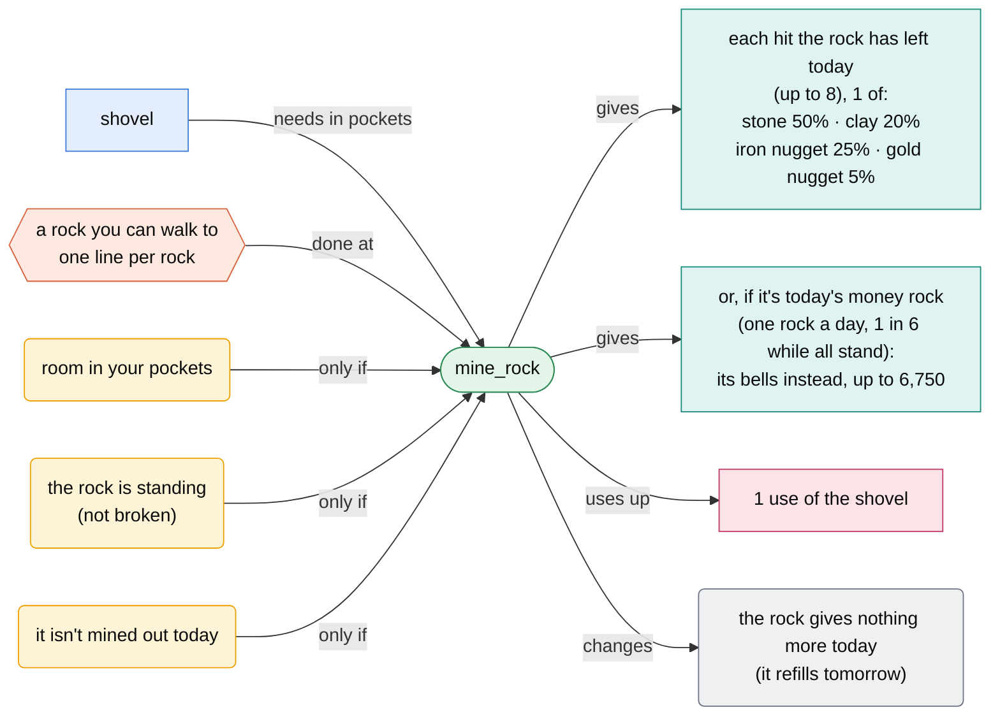

Can still fail when its hour comes: someone mined it out first; pockets full (what doesn't fit stays in the rock).

### 2. `break_rock`

On the list: *break_rock. items: shovel and apple. at: rock 3 (lower ground, centre) | rock 5 (lower ground, east). you eat the apple first, to be strong enough*

In a plan: `{"hour": 9, "pick": {"action": "break_rock", "at": "rock 3"}}`

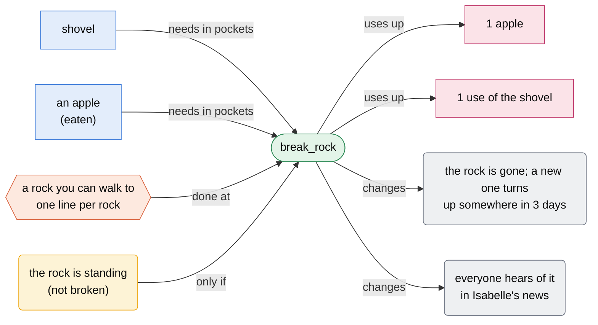

Can still fail when its hour comes: someone broke it first; the apple is gone.

### 3. `chop_wood`

On the list: *chop_wood. items: one of axe x1, stone axe x1. at: hardwood tree | fruit tree. the axe (not the stone axe) brings the tree down when it takes its last wood, and a fruit tree then drops its fruit*

In a plan: `{"hour": 9, "pick": {"action": "chop_wood", "items": {"axe": 1}, "at": "hardwood tree"}}`

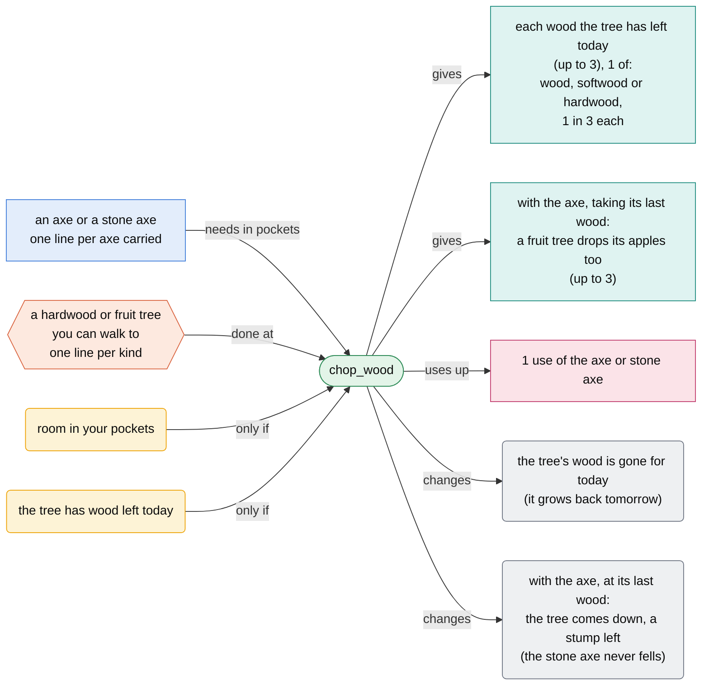

Can still fail when its hour comes: the wood was taken first; pockets full.

### 4. `shake_tree`

On the list: *shake_tree. at: fruit tree*

In a plan: `{"hour": 9, "pick": {"action": "shake_tree"}}`

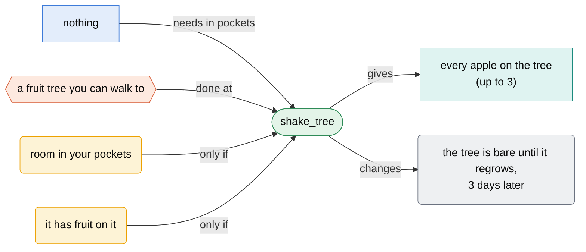

Can still fail when its hour comes: the fruit was taken first; pockets full.

### 5. `fish`

On the list: *fish. items: fishing rod, and if you like fishing bait x2. at: sea | river | pond | river up on the cliffs*

In a plan: `{"hour": 9, "pick": {"action": "fish", "at": "river"}}`

```mermaid
flowchart LR
    classDef act fill:#e3f4e8,stroke:#2e8b57,color:#0b0b0b
    classDef item fill:#e3edfb,stroke:#3d7bd9,color:#0b0b0b
    classDef place fill:#fde9df,stroke:#d9623d,color:#0b0b0b
    classDef cond fill:#fdf3d6,stroke:#eda100,color:#0b0b0b
    classDef gain fill:#dff3f1,stroke:#1a8a7d,color:#0b0b0b
    classDef spend fill:#fbe3e8,stroke:#c0396b,color:#0b0b0b
    classDef change fill:#eef0f2,stroke:#6b7280,color:#0b0b0b
    A(["fish"])
    It0["fishing rod"] -- "needs in pockets" --> A
    Pl0{{"the edge of the sea, the river,<br/>the pond or the river up on the cliffs<br/>you can walk to; one line per water"}} -- "done at" --> A
    Co0("room in your pockets") -- "only if" --> A
    A -- "gives" --> Ga0["a fish shadow in sight, or found<br/>looking from up to 3 spots:<br/>85% you catch it, 15% it gets away"]
    A -- "gives" --> Ga1["which fish: by weight among those<br/>out in that water at that hour,<br/>month and weather (tables below)"]
    A -- "gives" --> Ga2["no shadow found: nothing,<br/>the hour went on looking"]
    A -- "uses up" --> Sp0["1 use of the fishing rod<br/>(when a shadow was found)"]
    A -- "changes" --> Ch0("you see what it is<br/>(a shadow shows only its size)")
    class A act
    class It0 item
    class Pl0 place
    class Co0 cond
    class Ga0,Ga1,Ga2 gain
    class Sp0 spend
    class Ch0 change
```

Which fish are out changes hour by hour: only those whose hours, months and weather fit, and a fish you see as a shadow is drawn by weight from those. The chances above are with every one of them out; with fewer out, the rest share the weight.

**The sea**

| fish | weight | chance if all are out | shadow | hours | months | weather |
|---|---|---|---|---|---|---|
| sea bass | 20 | 28% | 5 | all day | all year | any |
| horse mackerel | 15 | 21% | 2 | all day | all year | any |
| anchovy | 12 | 17% | 2 | 04:00-21:00 | all year | any |
| olive flounder | 8 | 11% | 5 | all day | all year | any |
| squid | 8 | 11% | 3 | all day | 12, 1, 2, 3, 4, 5, 6, 7, 8 | any |
| red snapper | 4 | 5.7% | 4 | all day | all year | any |
| barred knifejaw | 2 | 2.8% | 3 | all day | 3, 4, 5, 6, 7, 8, 9, 10, 11 | any |
| tuna | 1 | 1.4% | 6 | all day | 11, 12, 1, 2, 3, 4 | any |
| coelacanth | 0.5 | 0.7% | 6 | all day | all year | wet |

**The river**

| fish | weight | chance if all are out | shadow | hours | months | weather |
|---|---|---|---|---|---|---|
| crucian carp | 15 | 31% | 2 | all day | all year | any |
| dace | 12 | 24% | 3 | 16:00-09:00 | all year | any |
| pale chub | 12 | 24% | 1 | 09:00-16:00 | all year | any |
| black bass | 10 | 20% | 4 | all day | all year | any |

**The pond**

| fish | weight | chance if all are out | shadow | hours | months | weather |
|---|---|---|---|---|---|---|
| carp | 12 | 43% | 4 | all day | all year | any |
| frog | 10 | 36% | 2 | all day | 5, 6, 7, 8 | any |
| goldfish | 4 | 14% | 1 | all day | all year | any |
| koi | 2 | 7.1% | 4 | 16:00-09:00 | all year | any |

**The river up on the cliffs**

| fish | weight | chance if all are out | shadow | hours | months | weather |
|---|---|---|---|---|---|---|
| crucian carp | 15 | 29% | 2 | all day | all year | any |
| dace | 12 | 23% | 3 | 16:00-09:00 | all year | any |
| pale chub | 12 | 23% | 1 | 09:00-16:00 | all year | any |
| black bass | 10 | 19% | 4 | all day | all year | any |
| char | 2 | 3.9% | 3 | 16:00-09:00 | 3, 4, 5, 6, 9, 10, 11 | any |
| golden trout | 0.3 | 0.6% | 3 | 16:00-09:00 | 3, 4, 5, 9, 10, 11 | any |

Can still fail when its hour comes: pockets full; the rod broke.

### 6. `fish (with bait)`

On the list: *fish. items: fishing rod, and if you like fishing bait x2. at: sea | river | pond | river up on the cliffs*

In a plan: `{"hour": 9, "pick": {"action": "fish", "items": {"fishing rod": 1, "fishing bait": 1}, "at": "river"}}`

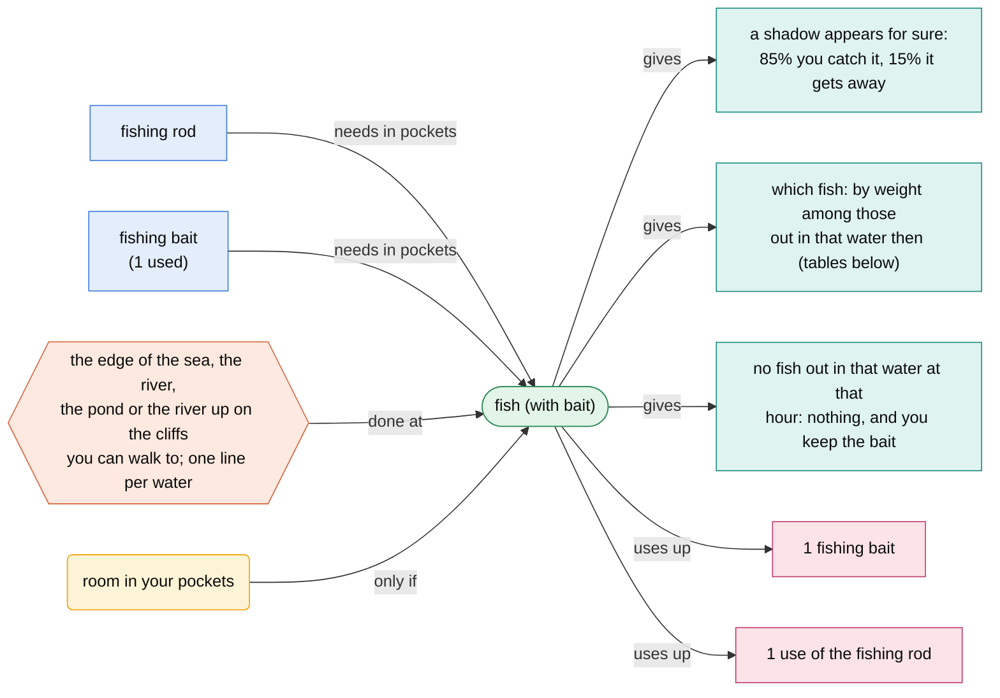

Can still fail when its hour comes: pockets full; the rod broke (with the bait gone, they fish without it and are told so).

### 7. `catch_bug`

On the list: *catch_bug. items: net. at: flowers | trees | stumps | rocks | grass*

In a plan: `{"hour": 9, "pick": {"action": "catch_bug", "at": "flowers"}}`

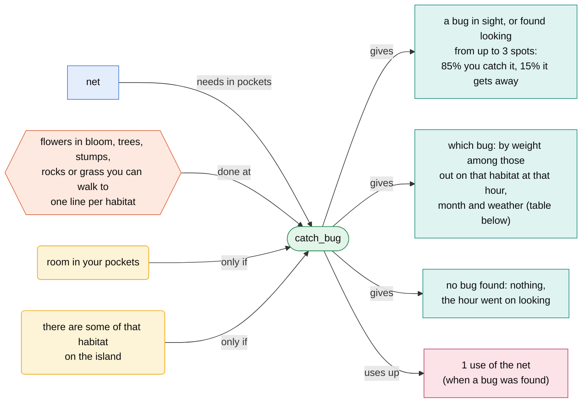

Only bugs whose hours, months and weather fit are out; the chances above are with all of them out.

**On flowers**

| bug | weight | chance if all are out | hours | months | weather |
|---|---|---|---|---|---|
| common butterfly | 15 | 26% | 04:00-19:00 | 9, 10, 11, 12, 1, 2, 3, 4, 5, 6 | dry |
| yellow butterfly | 12 | 21% | 04:00-19:00 | 3, 4, 5, 6, 9, 10 | dry |
| honeybee | 10 | 17% | 08:00-17:00 | 3, 4, 5, 6, 7 | dry |
| ladybug | 10 | 17% | 08:00-17:00 | 3, 4, 5, 6, 10 | dry |
| mantis | 6 | 10% | 08:00-17:00 | 3, 4, 5, 6, 7, 8, 9, 10, 11 | dry |
| peacock butterfly | 2 | 3.4% | 04:00-19:00 | 3, 4, 5, 6 | dry |
| orchid mantis | 2 | 3.4% | 08:00-17:00 | 3, 4, 5, 6, 7, 8, 9, 10, 11 | dry |
| emperor butterfly | 1 | 1.7% | 17:00-08:00 | 12, 1, 2, 3, 6, 7, 8, 9 | dry |

**On trees**

| bug | weight | chance if all are out | hours | months | weather |
|---|---|---|---|---|---|
| wasp | 3 | 57% | all day | all year | any |
| stag beetle | 2 | 38% | all day | 7, 8 | any |
| golden stag | 0.3 | 5.7% | 17:00-08:00 | 7, 8 | any |

**On stumps**

| bug | weight | chance if all are out | hours | months | weather |
|---|---|---|---|---|---|
| citrus long-horned beetle | 6 | 100% | all day | all year | any |

**On rocks**

| bug | weight | chance if all are out | hours | months | weather |
|---|---|---|---|---|---|
| pill bug | 8 | 50% | 23:00-16:00 | 9, 10, 11, 12, 1, 2, 3, 4, 5, 6 | any |
| snail | 8 | 50% | all day | all year | wet |

**In the grass**

| bug | weight | chance if all are out | hours | months | weather |
|---|---|---|---|---|---|
| grasshopper | 10 | 94% | 08:00-17:00 | 7, 8, 9 | dry |
| tarantula | 0.6 | 5.7% | 19:00-04:00 | 11, 12, 1, 2, 3, 4 | any |

Can still fail when its hour comes: pockets full; the net broke.

### 8. `beachcomb`

On the list: *beachcomb. at: beach*

In a plan: `{"hour": 9, "pick": {"action": "beachcomb"}}`

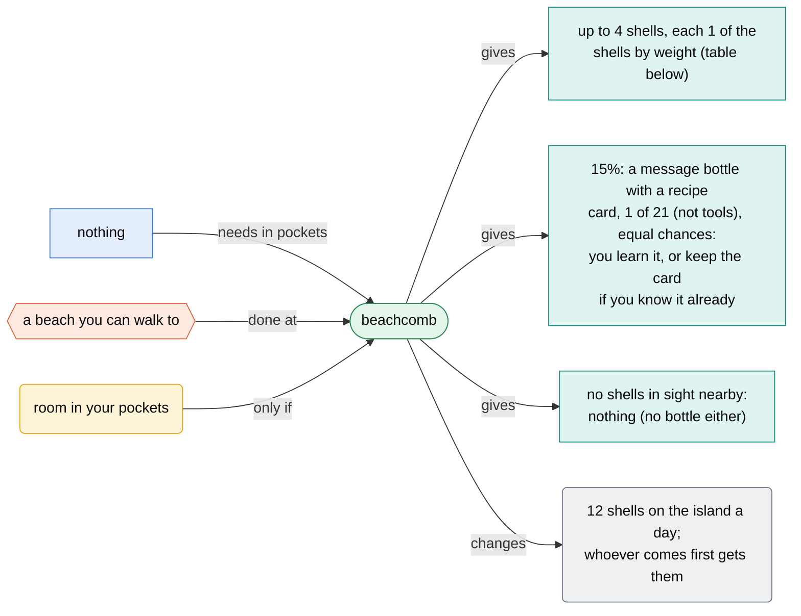

| shell | weight | chance each |
|---|---|---|
| cowrie | 6 | 24% |
| giant clam | 4 | 16% |
| venus comb | 4 | 16% |
| sand dollar | 4 | 16% |
| sea snail | 3 | 12% |
| scallop | 2 | 8% |
| coral | 1 | 4% |
| conch | 1 | 4% |

Can't fail when its hour comes: a picked-clean beach is still an hour on the beach.

### 9. `dig_fossil`

On the list: *dig_fossil. items: shovel. at: open ground*

In a plan: `{"hour": 9, "pick": {"action": "dig_fossil"}}`

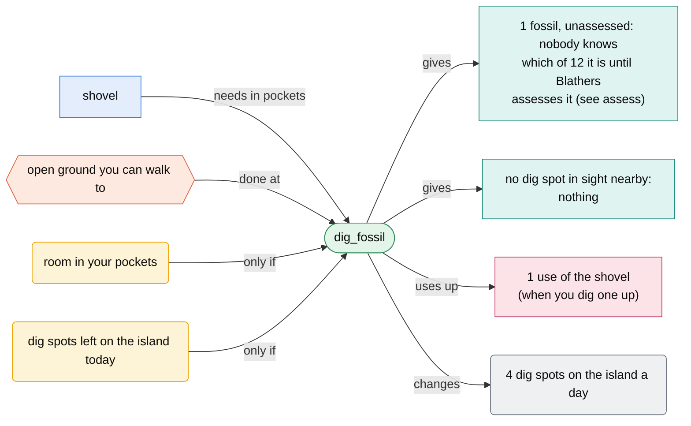

Can still fail when its hour comes: the last spots were dug first; pockets full.

### 10. `dig_clam`

On the list: *dig_clam (dig for manila clams). items: shovel. at: beach*

In a plan: `{"hour": 9, "pick": {"action": "dig_clam"}}`

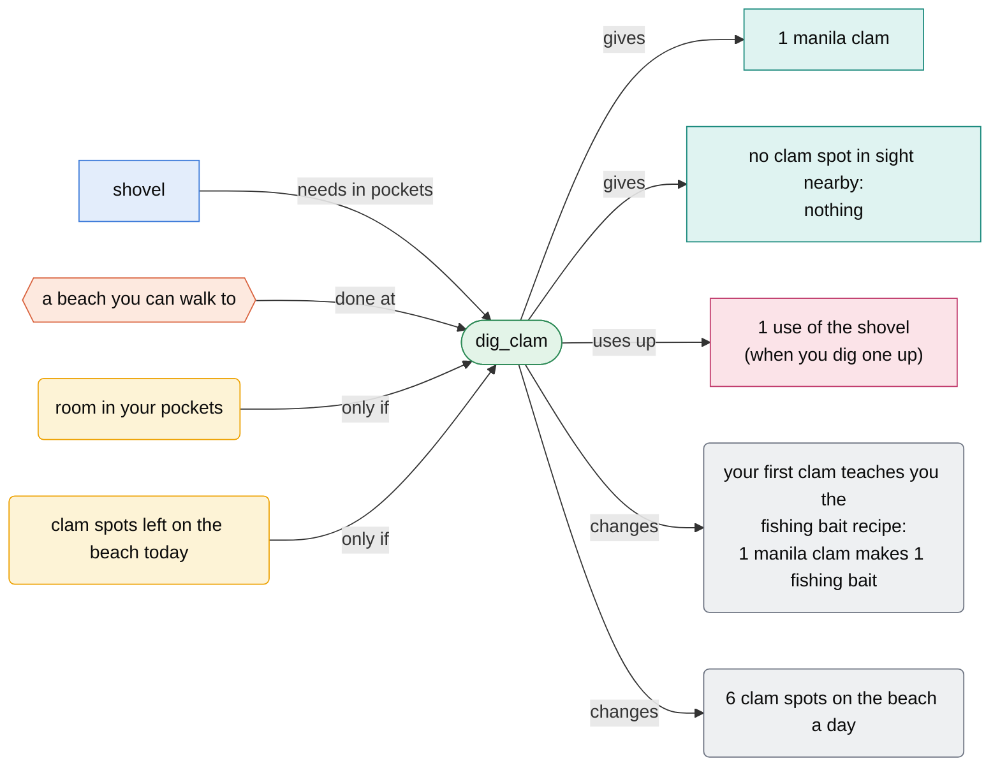

Can still fail when its hour comes: the last spots were dug first; pockets full.

### 11. `dig_stump`

On the list: *dig_stump (dig up a stump). items: shovel. at: stump*

In a plan: `{"hour": 9, "pick": {"action": "dig_stump"}}`

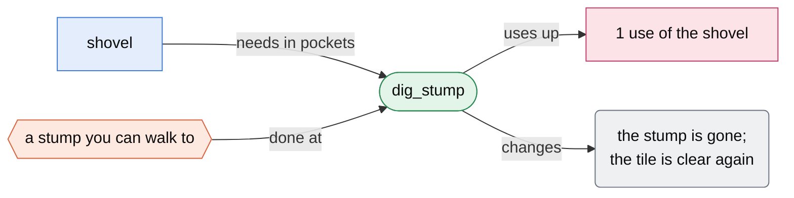

Can still fail when its hour comes: someone dug it up first.

## Bridges and stairs (from prompt version 17)

### 12. `propose_bridge`

On the list: *propose_bridge. a bridge across the river, at the nearest spot within 8 steps of where you are then; built once 98000 bells are donated at Resident Services; 2 of 10 on the island so far*

In a plan: `{"hour": 9, "pick": {"action": "propose_bridge"}}`

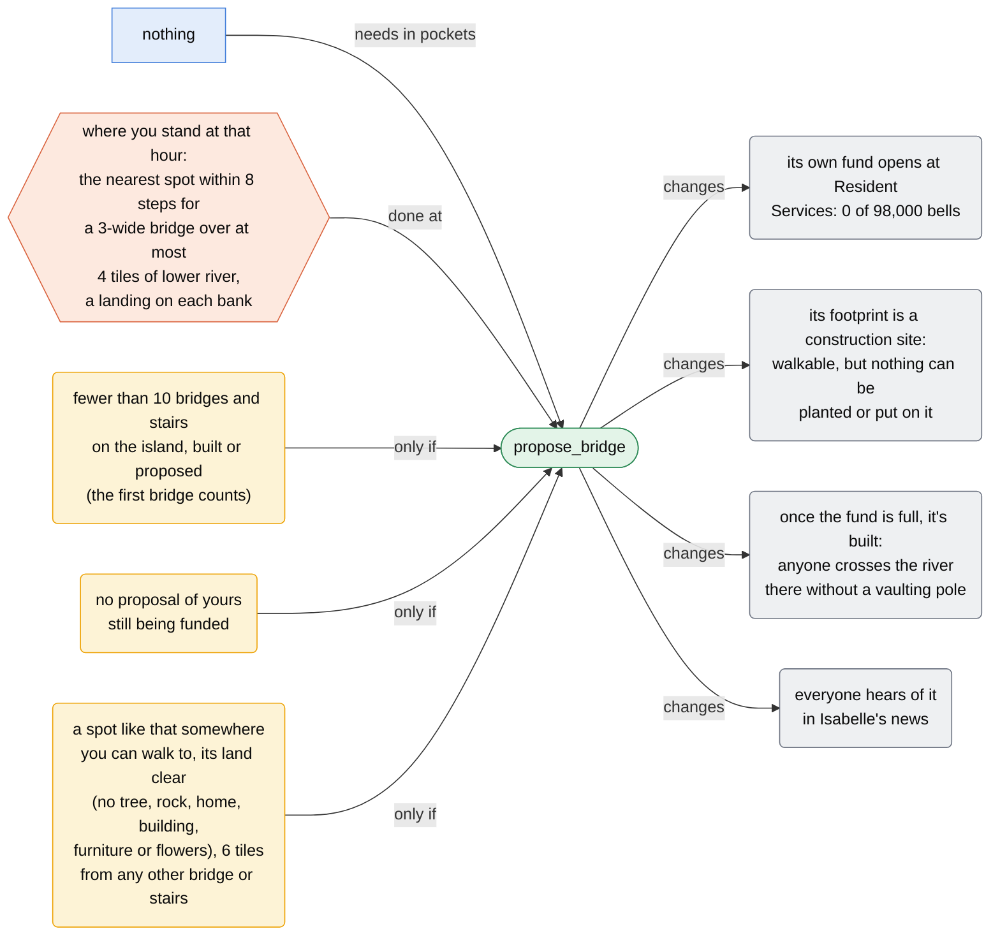

Can still fail when its hour comes: there's no such spot within 8 steps of where you are then (it says where the nearest is).

### 13. `propose_stairs`

On the list: *propose_stairs. stairs up a cliff, at the nearest spot within 8 steps of where you are then; built once 98000 bells are donated at Resident Services; 2 of 10 on the island so far*

In a plan: `{"hour": 9, "pick": {"action": "propose_stairs"}}`

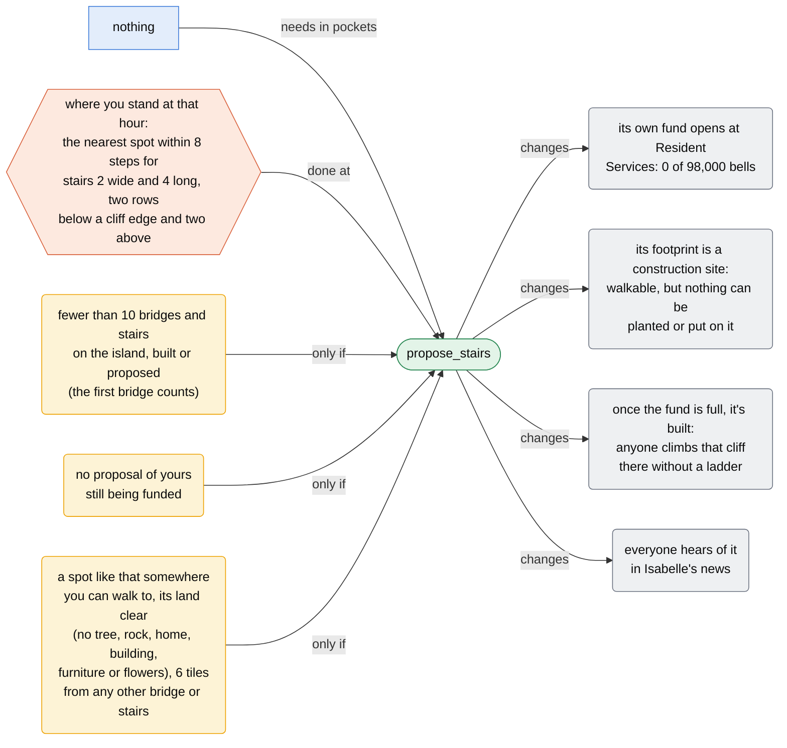

Can still fail when its hour comes: there's no such spot within 8 steps of where you are then (it says where the nearest is).

## Outside

### 14. `plant`

On the list: *plant. items: one of apple x3, sapling x1. at: a place from the list below (home if left out)*

In a plan: `{"hour": 9, "pick": {"action": "plant", "items": {"apple": 1}, "at": "north"}}`

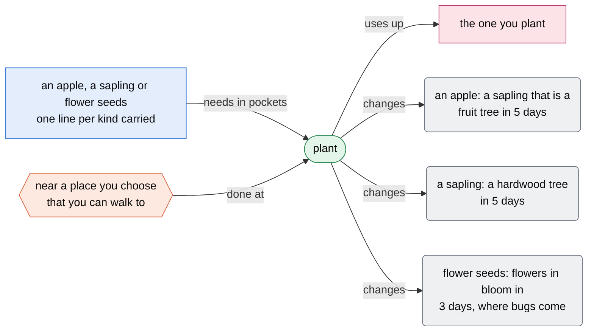

Can still fail when its hour comes: no free spot near there.

### 15. `place`

On the list: *place (put furniture or fencing outside). items: one of log stool x1, simple wooden fence x5. at: a place from the list below (home if left out)*

In a plan: `{"hour": 9, "pick": {"action": "place", "items": {"simple wooden fence": 3}, "at": "home"}}`

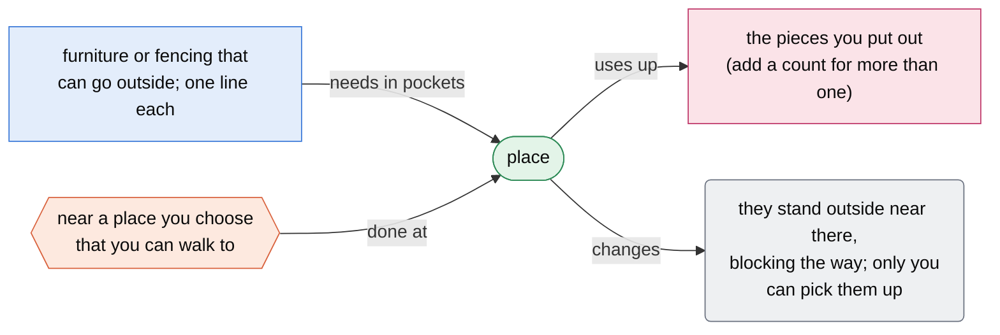

Can still fail when its hour comes: no free space near there.

### 16. `fence_off`

On the list: *fence_off (fence off around your home). items: simple wooden fence. at: home. one piece per tile, as far as your pieces go*

In a plan: `{"hour": 9, "pick": {"action": "fence_off"}}`

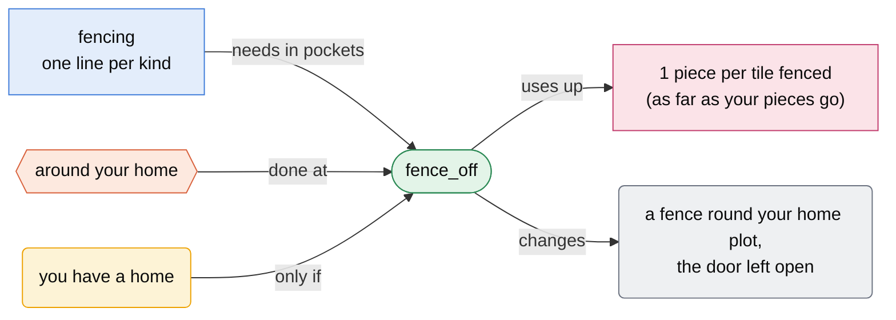

Can still fail when its hour comes: nothing left to fence there.

### 17. `pick_up`

On the list: *pick_up (something you put outside). what: log stool (1 out, lower ground, centre)*

In a plan: `{"hour": 9, "pick": {"action": "pick_up", "what": "log stool"}}`

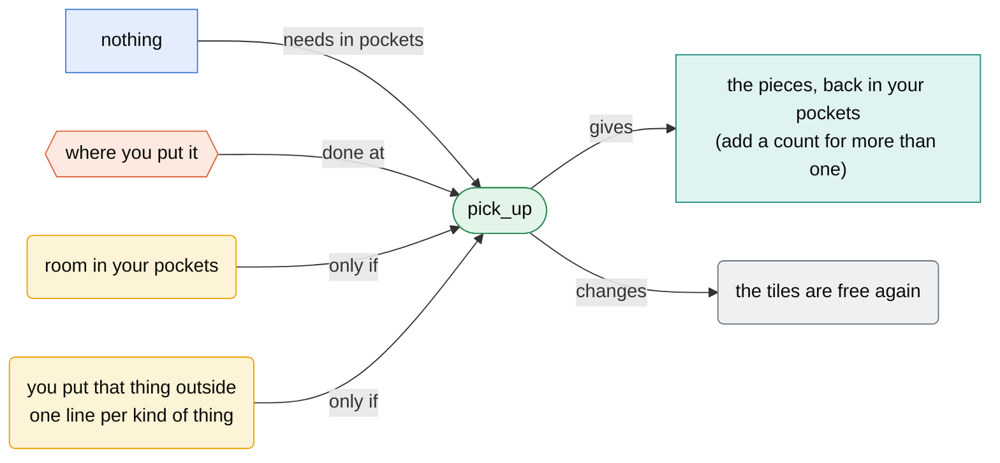

Can still fail when its hour comes: pockets full.

### 18. `lay_path`

On the list: *lay_path. also "style": dirt | stone | brick | sand | terracotta (or leave it out for dirt), "from": a place from the list below (or leave it out for home), "to": a place from the list below*

In a plan: `{"hour": 9, "pick": {"action": "lay_path", "style": "stone", "to": "museum"}}`

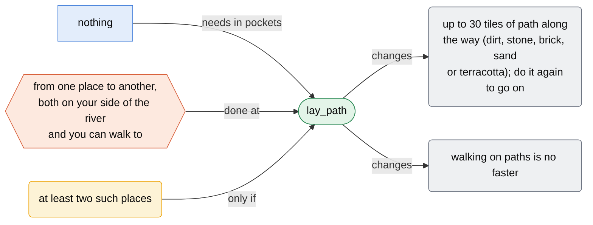

Can still fail when its hour comes: that stretch is already paved.

### 19. `remove_path`

On the list: *remove_path (take up path tiles you laid). at: lower ground, centre*

In a plan: `{"hour": 9, "pick": {"action": "remove_path"}}`

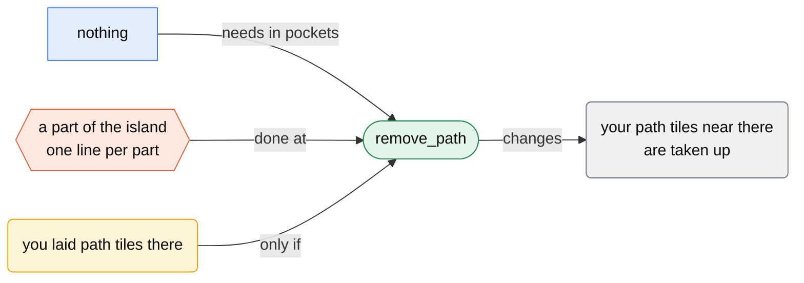

Can still fail when its hour comes: they were taken up already.

## At home, and clothes

### 20. `craft`

On the list: *craft. at: home. what: log stool | shovel*

In a plan: `{"hour": 9, "pick": {"action": "craft", "what": "log stool"}}`

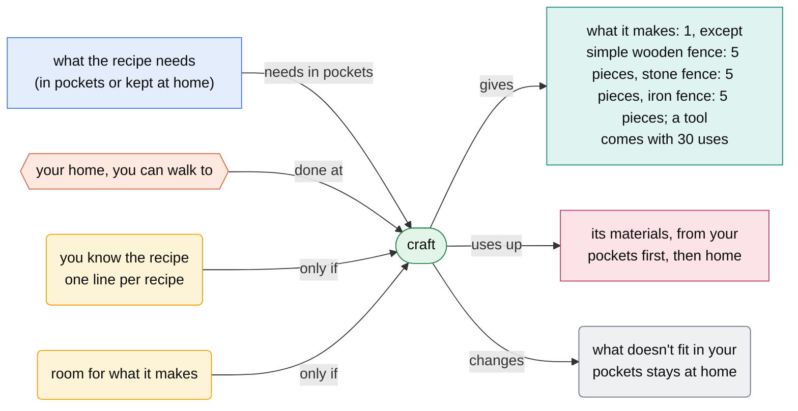

Can still fail when its hour comes: materials used or given away since; pockets full.

### 21. `decorate`

On the list: *decorate (put furniture inside your home). items: log stool. at: home*

In a plan: `{"hour": 9, "pick": {"action": "decorate"}}`

```mermaid
flowchart LR
    classDef act fill:#e3f4e8,stroke:#2e8b57,color:#0b0b0b
    classDef item fill:#e3edfb,stroke:#3d7bd9,color:#0b0b0b
    classDef place fill:#fde9df,stroke:#d9623d,color:#0b0b0b
    classDef cond fill:#fdf3d6,stroke:#eda100,color:#0b0b0b
    classDef gain fill:#dff3f1,stroke:#1a8a7d,color:#0b0b0b
    classDef spend fill:#fbe3e8,stroke:#c0396b,color:#0b0b0b
    classDef change fill:#eef0f2,stroke:#6b7280,color:#0b0b0b
    A(["decorate"])
    It0["the furniture<br/>one line per piece"] -- "needs in pockets" --> A
    Pl0{{"your home, you can walk to"}} -- "done at" --> A
    Co0("room inside your house") -- "only if" --> A
    A -- "uses up" --> Sp0["the piece, from your pockets"]
    A -- "changes" --> Ch0("it stands inside your home;<br/>visitors see it")
    class A act
    class It0 item
    class Pl0 place
    class Co0 cond
    class Sp0 spend
    class Ch0 change
```

Can still fail when its hour comes: it was given away or put outside since.

### 22. `undecorate`

On the list: *undecorate (take furniture out of your home). at: home. what: log stool*

In a plan: `{"hour": 9, "pick": {"action": "undecorate"}}`

```mermaid
flowchart LR
    classDef act fill:#e3f4e8,stroke:#2e8b57,color:#0b0b0b
    classDef item fill:#e3edfb,stroke:#3d7bd9,color:#0b0b0b
    classDef place fill:#fde9df,stroke:#d9623d,color:#0b0b0b
    classDef cond fill:#fdf3d6,stroke:#eda100,color:#0b0b0b
    classDef gain fill:#dff3f1,stroke:#1a8a7d,color:#0b0b0b
    classDef spend fill:#fbe3e8,stroke:#c0396b,color:#0b0b0b
    classDef change fill:#eef0f2,stroke:#6b7280,color:#0b0b0b
    A(["undecorate"])
    It0["nothing"] -- "needs in pockets" --> A
    Pl0{{"your home, you can walk to"}} -- "done at" --> A
    Co0("room in your pockets") -- "only if" --> A
    Co1("it is inside your home<br/>one line per piece") -- "only if" --> A
    A -- "gives" --> Ga0["the piece, back in your pockets"]
    class A act
    class It0 item
    class Pl0 place
    class Co0,Co1 cond
    class Ga0 gain
```

Can still fail when its hour comes: pockets full.

### 23. `wear`

On the list: *wear (put on clothes). items: one of kimono x1, straw hat x1*

In a plan: `{"hour": 9, "pick": {"action": "wear", "items": {"straw hat": 1}}}`

```mermaid
flowchart LR
    classDef act fill:#e3f4e8,stroke:#2e8b57,color:#0b0b0b
    classDef item fill:#e3edfb,stroke:#3d7bd9,color:#0b0b0b
    classDef place fill:#fde9df,stroke:#d9623d,color:#0b0b0b
    classDef cond fill:#fdf3d6,stroke:#eda100,color:#0b0b0b
    classDef gain fill:#dff3f1,stroke:#1a8a7d,color:#0b0b0b
    classDef spend fill:#fbe3e8,stroke:#c0396b,color:#0b0b0b
    classDef change fill:#eef0f2,stroke:#6b7280,color:#0b0b0b
    A(["wear"])
    It0["the clothing<br/>one line per piece"] -- "needs in pockets" --> A
    Pl0{{"wherever you are"}} -- "done at" --> A
    A -- "changes" --> Ch0("you wear it, and others see it")
    A -- "changes" --> Ch1("what you wore in that slot<br/>goes back to your pockets")
    class A act
    class It0 item
    class Pl0 place
    class Ch0,Ch1 change
```

Can still fail when its hour comes: it was given away since.

## Visiting

### 24. `visit`

On the list: *visit. at: Ari's home (lower ground, east) | Jo's home (lower ground, west)*

In a plan: `{"hour": 9, "pick": {"action": "visit", "at": "Jo's home"}}`

```mermaid
flowchart LR
    classDef act fill:#e3f4e8,stroke:#2e8b57,color:#0b0b0b
    classDef item fill:#e3edfb,stroke:#3d7bd9,color:#0b0b0b
    classDef place fill:#fde9df,stroke:#d9623d,color:#0b0b0b
    classDef cond fill:#fdf3d6,stroke:#eda100,color:#0b0b0b
    classDef gain fill:#dff3f1,stroke:#1a8a7d,color:#0b0b0b
    classDef spend fill:#fbe3e8,stroke:#c0396b,color:#0b0b0b
    classDef change fill:#eef0f2,stroke:#6b7280,color:#0b0b0b
    A(["visit"])
    It0["nothing"] -- "needs in pockets" --> A
    Pl0{{"the other villager's home<br/>you can walk to; one line per villager"}} -- "done at" --> A
    Co0("they have a home") -- "only if" --> A
    A -- "changes" --> Ch0("they're home, awake and free: they<br/>let you in, you see what's inside,<br/>and you can talk (gifts, requests,<br/>trades), free of any action")
    A -- "changes" --> Ch1("nobody answers: they hear<br/>later that you came by")
    class A act
    class It0 item
    class Pl0 place
    class Co0 cond
    class Ch0,Ch1 change
```

Can't fail when its hour comes.

### 25. `send`

On the list: *send (someone a letter or things from your pockets). items: any of bells x300, sea bass x2, wood x4. at: Ari | Jo. also "note": what you write (up to 350 characters). a note, things, or both; it arrives tomorrow morning*

In a plan: `{"hour": 9, "pick": {"action": "send", "items": {"wood": 2}, "at": "Jo", "note": "for your fence"}}`

```mermaid
flowchart LR
    classDef act fill:#e3f4e8,stroke:#2e8b57,color:#0b0b0b
    classDef item fill:#e3edfb,stroke:#3d7bd9,color:#0b0b0b
    classDef place fill:#fde9df,stroke:#d9623d,color:#0b0b0b
    classDef cond fill:#fdf3d6,stroke:#eda100,color:#0b0b0b
    classDef gain fill:#dff3f1,stroke:#1a8a7d,color:#0b0b0b
    classDef spend fill:#fbe3e8,stroke:#c0396b,color:#0b0b0b
    classDef change fill:#eef0f2,stroke:#6b7280,color:#0b0b0b
    A(["send"])
    It0["anything you carry, bells too<br/>(none for a letter)"] -- "needs in pockets" --> A
    Pl0{{"wherever you are;<br/>to another villager<br/>one line per villager"}} -- "done at" --> A
    Co0("there is another villager") -- "only if" --> A
    A -- "uses up" --> Sp0["the things you send<br/>(they leave your pockets now)"]
    A -- "changes" --> Ch0("tomorrow morning they get it:<br/>the note among their letters,<br/>the things in their pockets<br/>(at home if there's no room)")
    A -- "changes" --> Ch1("things sent count as a gift:<br/>they close a request for them")
    class A act
    class It0 item
    class Pl0 place
    class Co0 cond
    class Sp0 spend
    class Ch0,Ch1 change
```

Sending is one thing, written the same way in the three places it can happen. Only the first is an
action on the plan's list; the other two are part of that turn's reply.

| where | how it's written | to whom | when it gets there | costs |
|---|---|---|---|---|
| a plan (new in version 21) | `{"hour": 10, "pick": {"action": "send", "at": "Jo", "items": {"wood": 2}, "note": "for your fence"}}` | any other villager, from wherever they are | the next morning | one of the day's actions and its hour |
| a turn at the plaza | `"send": [{"action": "send", "at": "Jo", "items": {"wood": 2}, "note": "for your fence"}]`, as many as they like | any other villager | the next morning | nothing more than the hour at the plaza |
| a turn in a conversation | `"send": {"action": "send", "items": {"wood": 2}}` | the one they're talking to | at once | nothing more than the line they say |

- `"items"` alone is a parcel, a `"note"` alone is a letter (up to 350 characters), both is a parcel with a
  note (up to 300). Bells go as `"bells"`. A conversation's send has no note: they are already talking.
- Only what is in their pockets can be sent. A planned send that names something else isn't planned; at the
  plaza or in a conversation it doesn't go through and they are told why.
- By mail the things leave their pockets when it is sent. What doesn't fit in the other's pockets in the
  morning is left at their home if there's room, and waits for them otherwise.
- Things sent count as a gift either way: they close an open request for them, and both remember who gave
  what to whom.
- Before version 21 the plaza wrote `"letters": [{"to", "content"}]` and `"parcels": [{"to", "items", "note"}]`,
  a conversation wrote `"give": {...}`, and a plan couldn't send at all. When each arrives hasn't changed.
- In `events.jsonl` a planned send is an `action`, plus the same `parcel` or `message` record the plaza
  writes; a parcel's arrival is a `gift` with `how: "by mail"`, a conversation's a `gift` with
  `how: "in person"`.

Can still fail when its hour comes: the things are gone from your pockets.

## Shops and services

### 26. `ask`

On the list: *ask (what they do and what it costs). at: Tom Nook (Resident Services) | Isabelle (Resident Services) | Blathers (museum) | Timmy and Tommy (Nook's Cranny) | Able Sisters*

In a plan: `{"hour": 9, "pick": {"action": "ask", "at": "Tom Nook"}}`

```mermaid
flowchart LR
    classDef act fill:#e3f4e8,stroke:#2e8b57,color:#0b0b0b
    classDef item fill:#e3edfb,stroke:#3d7bd9,color:#0b0b0b
    classDef place fill:#fde9df,stroke:#d9623d,color:#0b0b0b
    classDef cond fill:#fdf3d6,stroke:#eda100,color:#0b0b0b
    classDef gain fill:#dff3f1,stroke:#1a8a7d,color:#0b0b0b
    classDef spend fill:#fbe3e8,stroke:#c0396b,color:#0b0b0b
    classDef change fill:#eef0f2,stroke:#6b7280,color:#0b0b0b
    A(["ask"])
    It0["nothing"] -- "needs in pockets" --> A
    Pl0{{"Resident Services (Tom Nook, Isabelle),<br/>the museum (Blathers), Nook's Cranny<br/>(Timmy and Tommy) or the Able Sisters<br/>you can walk to; one line per person"}} -- "done at" --> A
    Co0("it's open during the plan<br/>Nook's Cranny 08:00-22:00,<br/>Able Sisters 09:00-21:00,<br/>the others all day") -- "only if" --> A
    A -- "gives" --> Ga0["Tom Nook or Isabelle, when you<br/>carry no map and have room:<br/>an island map"]
    A -- "changes" --> Ch0("you hear what they do and what<br/>it costs (houses, moves, bridges<br/>and stairs; ordinances; the museum;<br/>prices; clothes)")
    A -- "changes" --> Ch1("Timmy and Tommy: what they'd pay<br/>for what you carry joins the<br/>prices you've heard")
    class A act
    class It0 item
    class Pl0 place
    class Co0 cond
    class Ga0 gain
    class Ch0,Ch1 change
```

Can't fail when its hour comes.

### 27. `sell`

On the list: *sell. items: any of sea bass x2, shovel x1, wood x4. at: Nook's Cranny*

In a plan: `{"hour": 9, "pick": {"action": "sell", "items": {"sea bass": 2, "wood": 1}}}`

```mermaid
flowchart LR
    classDef act fill:#e3f4e8,stroke:#2e8b57,color:#0b0b0b
    classDef item fill:#e3edfb,stroke:#3d7bd9,color:#0b0b0b
    classDef place fill:#fde9df,stroke:#d9623d,color:#0b0b0b
    classDef cond fill:#fdf3d6,stroke:#eda100,color:#0b0b0b
    classDef gain fill:#dff3f1,stroke:#1a8a7d,color:#0b0b0b
    classDef spend fill:#fbe3e8,stroke:#c0396b,color:#0b0b0b
    classDef change fill:#eef0f2,stroke:#6b7280,color:#0b0b0b
    A(["sell"])
    It0["things Timmy and Tommy buy"] -- "needs in pockets" --> A
    Pl0{{"Nook's Cranny, you can walk to"}} -- "done at" --> A
    Co0("open during the plan<br/>08:00-22:00") -- "only if" --> A
    A -- "gives" --> Ga0["bells: each thing's Cranny price<br/>(more under Bell Boom)"]
    A -- "uses up" --> Sp0["the things sold"]
    A -- "changes" --> Ch0("their prices join the<br/>prices you've heard")
    class A act
    class It0 item
    class Pl0 place
    class Co0 cond
    class Ga0 gain
    class Sp0 spend
    class Ch0 change
```

Can still fail when its hour comes: none of it is in your pockets any more.

### 28. `buy (a thing)`

On the list: *buy. at: Nook's Cranny. what: fishing bait (300 bells each, up to 3) | sapling (640 bells) | shovel (new, 800 bells) | shovel recipe (200 bells) (for more than one, {"<thing>": <how many>})*

In a plan: `{"hour": 9, "pick": {"action": "buy", "what": {"fishing bait": 2}}}`

```mermaid
flowchart LR
    classDef act fill:#e3f4e8,stroke:#2e8b57,color:#0b0b0b
    classDef item fill:#e3edfb,stroke:#3d7bd9,color:#0b0b0b
    classDef place fill:#fde9df,stroke:#d9623d,color:#0b0b0b
    classDef cond fill:#fdf3d6,stroke:#eda100,color:#0b0b0b
    classDef gain fill:#dff3f1,stroke:#1a8a7d,color:#0b0b0b
    classDef spend fill:#fbe3e8,stroke:#c0396b,color:#0b0b0b
    classDef change fill:#eef0f2,stroke:#6b7280,color:#0b0b0b
    A(["buy (a thing)"])
    It0["bells for one<br/>(in your wallet)"] -- "needs in pockets" --> A
    Pl0{{"Nook's Cranny, you can walk to"}} -- "done at" --> A
    Co0("open during the plan<br/>08:00-22:00") -- "only if" --> A
    Co1("it's in today's stock<br/>one line per thing") -- "only if" --> A
    Co2("room in your pockets") -- "only if" --> A
    A -- "gives" --> Ga0["the thing; up to 10 at once,<br/>as many as you can pay<br/>for and carry"]
    A -- "uses up" --> Sp0["its price in bells, each"]
    class A act
    class It0 item
    class Pl0 place
    class Co0,Co1,Co2 cond
    class Ga0 gain
    class Sp0 spend
```

Can still fail when its hour comes: bells spent since; pockets full.

### 29. `buy (a tool)`

On the list: *the same line*

In a plan: `{"hour": 9, "pick": {"action": "buy", "what": "shovel"}}`

```mermaid
flowchart LR
    classDef act fill:#e3f4e8,stroke:#2e8b57,color:#0b0b0b
    classDef item fill:#e3edfb,stroke:#3d7bd9,color:#0b0b0b
    classDef place fill:#fde9df,stroke:#d9623d,color:#0b0b0b
    classDef cond fill:#fdf3d6,stroke:#eda100,color:#0b0b0b
    classDef gain fill:#dff3f1,stroke:#1a8a7d,color:#0b0b0b
    classDef spend fill:#fbe3e8,stroke:#c0396b,color:#0b0b0b
    classDef change fill:#eef0f2,stroke:#6b7280,color:#0b0b0b
    A(["buy (a tool)"])
    It0["bells for one<br/>(in your wallet)"] -- "needs in pockets" --> A
    Pl0{{"Nook's Cranny, you can walk to"}} -- "done at" --> A
    Co0("open during the plan<br/>08:00-22:00") -- "only if" --> A
    Co1("one line per tool<br/>(always in stock)") -- "only if" --> A
    Co2("room in your pockets") -- "only if" --> A
    A -- "gives" --> Ga0["a new tool with 30 uses"]
    A -- "uses up" --> Sp0["its price in bells, each"]
    class A act
    class It0 item
    class Pl0 place
    class Co0,Co1,Co2 cond
    class Ga0 gain
    class Sp0 spend
```

Can still fail when its hour comes: bells spent since; pockets full.

### 30. `buy (a recipe card)`

On the list: *the same line*

In a plan: `{"hour": 9, "pick": {"action": "buy", "what": "shovel recipe"}}`

```mermaid
flowchart LR
    classDef act fill:#e3f4e8,stroke:#2e8b57,color:#0b0b0b
    classDef item fill:#e3edfb,stroke:#3d7bd9,color:#0b0b0b
    classDef place fill:#fde9df,stroke:#d9623d,color:#0b0b0b
    classDef cond fill:#fdf3d6,stroke:#eda100,color:#0b0b0b
    classDef gain fill:#dff3f1,stroke:#1a8a7d,color:#0b0b0b
    classDef spend fill:#fbe3e8,stroke:#c0396b,color:#0b0b0b
    classDef change fill:#eef0f2,stroke:#6b7280,color:#0b0b0b
    A(["buy (a recipe card)"])
    It0["bells for it<br/>(in your wallet)"] -- "needs in pockets" --> A
    Pl0{{"Nook's Cranny, you can walk to"}} -- "done at" --> A
    Co0("open during the plan<br/>08:00-22:00") -- "only if" --> A
    Co1("it's for sale today<br/>(tool cards always, plus one)") -- "only if" --> A
    Co2("room in your pockets,<br/>only if you already know it") -- "only if" --> A
    A -- "gives" --> Ga0["a card for a recipe you<br/>already know: the card"]
    A -- "uses up" --> Sp0["its price in bells"]
    A -- "changes" --> Ch0("you learn the recipe, and<br/>what it needs")
    class A act
    class It0 item
    class Pl0 place
    class Co0,Co1,Co2 cond
    class Ga0 gain
    class Sp0 spend
    class Ch0 change
```

Can still fail when its hour comes: bells spent since.

### 31. `buy (clothes)`

On the list: *buy. at: Able Sisters. what: kimono (4800 bells) | raincoat (1600 bells)*

In a plan: `{"hour": 9, "pick": {"action": "buy", "what": "kimono"}}`

```mermaid
flowchart LR
    classDef act fill:#e3f4e8,stroke:#2e8b57,color:#0b0b0b
    classDef item fill:#e3edfb,stroke:#3d7bd9,color:#0b0b0b
    classDef place fill:#fde9df,stroke:#d9623d,color:#0b0b0b
    classDef cond fill:#fdf3d6,stroke:#eda100,color:#0b0b0b
    classDef gain fill:#dff3f1,stroke:#1a8a7d,color:#0b0b0b
    classDef spend fill:#fbe3e8,stroke:#c0396b,color:#0b0b0b
    classDef change fill:#eef0f2,stroke:#6b7280,color:#0b0b0b
    A(["buy (clothes)"])
    It0["bells for it<br/>(in your wallet)"] -- "needs in pockets" --> A
    Pl0{{"the Able Sisters, you can walk to"}} -- "done at" --> A
    Co0("open during the plan<br/>09:00-21:00") -- "only if" --> A
    Co1("it's in today's stock<br/>one line per piece") -- "only if" --> A
    Co2("room in your pockets") -- "only if" --> A
    A -- "gives" --> Ga0["the piece of clothing"]
    A -- "uses up" --> Sp0["its price in bells"]
    class A act
    class It0 item
    class Pl0 place
    class Co0,Co1,Co2 cond
    class Ga0 gain
    class Sp0 spend
```

Can still fail when its hour comes: bells spent since; pockets full.

### 32. `assess`

On the list: *assess. items: fossil. at: museum. Blathers assesses every fossil you carry*

In a plan: `{"hour": 9, "pick": {"action": "assess"}}`

```mermaid
flowchart LR
    classDef act fill:#e3f4e8,stroke:#2e8b57,color:#0b0b0b
    classDef item fill:#e3edfb,stroke:#3d7bd9,color:#0b0b0b
    classDef place fill:#fde9df,stroke:#d9623d,color:#0b0b0b
    classDef cond fill:#fdf3d6,stroke:#eda100,color:#0b0b0b
    classDef gain fill:#dff3f1,stroke:#1a8a7d,color:#0b0b0b
    classDef spend fill:#fbe3e8,stroke:#c0396b,color:#0b0b0b
    classDef change fill:#eef0f2,stroke:#6b7280,color:#0b0b0b
    A(["assess"])
    It0["an unassessed fossil"] -- "needs in pockets" --> A
    Pl0{{"the museum, you can walk to"}} -- "done at" --> A
    Co0("open (all day)") -- "only if" --> A
    A -- "gives" --> Ga0["each becomes 1 of 12 fossils,<br/>equal chances (table below)"]
    A -- "uses up" --> Sp0["every unassessed fossil<br/>you carry"]
    A -- "changes" --> Ch0("now the museum takes them, and<br/>the Cranny pays 1,000 to 6,000")
    class A act
    class It0 item
    class Pl0 place
    class Co0 cond
    class Ga0 gain
    class Sp0 spend
    class Ch0 change
```

Each of these equally likely (1 in 12): amber, ammonite, ankylo skull, archaeopteryx, coprolite, dinosaur track, dunkleosteus, ptera body, shark-tooth pattern, stego skull, t. rex skull, trilobite.

Can still fail when its hour comes: the fossils are gone from your pockets.

### 33. `donate`

On the list: *donate. items: one of dace x1, sea bass x2. at: museum*

In a plan: `{"hour": 9, "pick": {"action": "donate", "items": {"sea bass": 1}}}`

```mermaid
flowchart LR
    classDef act fill:#e3f4e8,stroke:#2e8b57,color:#0b0b0b
    classDef item fill:#e3edfb,stroke:#3d7bd9,color:#0b0b0b
    classDef place fill:#fde9df,stroke:#d9623d,color:#0b0b0b
    classDef cond fill:#fdf3d6,stroke:#eda100,color:#0b0b0b
    classDef gain fill:#dff3f1,stroke:#1a8a7d,color:#0b0b0b
    classDef spend fill:#fbe3e8,stroke:#c0396b,color:#0b0b0b
    classDef change fill:#eef0f2,stroke:#6b7280,color:#0b0b0b
    A(["donate"])
    It0["a fish, bug or assessed fossil<br/>one line per kind"] -- "needs in pockets" --> A
    Pl0{{"the museum, you can walk to"}} -- "done at" --> A
    Co0("open (all day)") -- "only if" --> A
    Co1("the museum doesn't have one yet") -- "only if" --> A
    A -- "gives" --> Ga0["no bells"]
    A -- "uses up" --> Sp0["the one you donate"]
    A -- "changes" --> Ch0("the museum has it, with your<br/>name, for everyone to see")
    A -- "changes" --> Ch1("everyone hears of it<br/>in Isabelle's news")
    class A act
    class It0 item
    class Pl0 place
    class Co0,Co1 cond
    class Ga0 gain
    class Sp0 spend
    class Ch0,Ch1 change
```

Can still fail when its hour comes: someone donated one first; it's gone from your pockets.

### 34. `upgrade_house`

On the list: *upgrade_house. at: Resident Services. Tom Nook upgrades your tent*

In a plan: `{"hour": 9, "pick": {"action": "upgrade_house"}}`

```mermaid
flowchart LR
    classDef act fill:#e3f4e8,stroke:#2e8b57,color:#0b0b0b
    classDef item fill:#e3edfb,stroke:#3d7bd9,color:#0b0b0b
    classDef place fill:#fde9df,stroke:#d9623d,color:#0b0b0b
    classDef cond fill:#fdf3d6,stroke:#eda100,color:#0b0b0b
    classDef gain fill:#dff3f1,stroke:#1a8a7d,color:#0b0b0b
    classDef spend fill:#fbe3e8,stroke:#c0396b,color:#0b0b0b
    classDef change fill:#eef0f2,stroke:#6b7280,color:#0b0b0b
    A(["upgrade_house"])
    It0["nothing"] -- "needs in pockets" --> A
    Pl0{{"Resident Services, you can walk to"}} -- "done at" --> A
    Co0("open (all day)") -- "only if" --> A
    Co1("no loan owed") -- "only if" --> A
    Co2("a bigger house to go to") -- "only if" --> A
    A -- "changes" --> Ch0("the next house, right away:<br/>more storage and room inside<br/>(table below)")
    A -- "changes" --> Ch1("a loan for its cost<br/>(no interest, no deadline);<br/>paid off before the next one")
    class A act
    class It0 item
    class Pl0 place
    class Co0,Co1,Co2 cond
    class Ch0,Ch1 change
```

| house | loan (bells) | storage at home | furniture inside |
|---|---|---|---|
| tent | 0 | 0 | 6 |
| house | 98,000 | 80 | 12 |
| bigger house | 198,000 | 120 | 18 |
| house with back room | 348,000 | 240 | 30 |
| two-story house | 548,000 | 320 | 40 |

Can't fail when its hour comes.

### 35. `pay_loan`

On the list: *pay_loan. items: bells, 1 to 5000 (5000 if left out). at: Resident Services. you owe 98000*

In a plan: `{"hour": 9, "pick": {"action": "pay_loan", "items": {"bells": 2000}}}`

```mermaid
flowchart LR
    classDef act fill:#e3f4e8,stroke:#2e8b57,color:#0b0b0b
    classDef item fill:#e3edfb,stroke:#3d7bd9,color:#0b0b0b
    classDef place fill:#fde9df,stroke:#d9623d,color:#0b0b0b
    classDef cond fill:#fdf3d6,stroke:#eda100,color:#0b0b0b
    classDef gain fill:#dff3f1,stroke:#1a8a7d,color:#0b0b0b
    classDef spend fill:#fbe3e8,stroke:#c0396b,color:#0b0b0b
    classDef change fill:#eef0f2,stroke:#6b7280,color:#0b0b0b
    A(["pay_loan"])
    It0["bells<br/>(in your wallet)"] -- "needs in pockets" --> A
    Pl0{{"Resident Services, you can walk to"}} -- "done at" --> A
    Co0("open (all day)") -- "only if" --> A
    Co1("a loan owed") -- "only if" --> A
    A -- "uses up" --> Sp0["the bells you pay<br/>(up to what you owe)"]
    A -- "changes" --> Ch0("the loan goes down; at 0<br/>you can upgrade again")
    class A act
    class It0 item
    class Pl0 place
    class Co0,Co1 cond
    class Sp0 spend
    class Ch0 change
```

Can still fail when its hour comes: the wallet is empty by then.

### 36. `contribute_bridge`

On the list: *contribute_bridge (put bells toward a bridge or stairs). items: bells, 1 to 5000. at: Resident Services. what: bridge to the north bank (750/98000 raised) | stairs up to the middle cliff (north) (0/98000 raised, Ari's proposal)*

In a plan: `{"hour": 9, "pick": {"action": "contribute_bridge", "items": {"bells": 500}, "what": "bridge to the north bank"}}`

```mermaid
flowchart LR
    classDef act fill:#e3f4e8,stroke:#2e8b57,color:#0b0b0b
    classDef item fill:#e3edfb,stroke:#3d7bd9,color:#0b0b0b
    classDef place fill:#fde9df,stroke:#d9623d,color:#0b0b0b
    classDef cond fill:#fdf3d6,stroke:#eda100,color:#0b0b0b
    classDef gain fill:#dff3f1,stroke:#1a8a7d,color:#0b0b0b
    classDef spend fill:#fbe3e8,stroke:#c0396b,color:#0b0b0b
    classDef change fill:#eef0f2,stroke:#6b7280,color:#0b0b0b
    A(["contribute_bridge"])
    It0["bells<br/>(in your wallet)"] -- "needs in pockets" --> A
    Pl0{{"Resident Services, you can walk to"}} -- "done at" --> A
    Co0("open (all day)") -- "only if" --> A
    Co1("that bridge or stairs isn't built yet<br/>one line per fund: the first bridge<br/>and each proposal (version 17)") -- "only if" --> A
    A -- "uses up" --> Sp0["the bells you put in<br/>(up to what the fund still needs)"]
    A -- "changes" --> Ch0("that fund goes up; at 98,000<br/>it's built at once: a crossing,<br/>or stairs")
    A -- "changes" --> Ch1("everyone hears of a finished one<br/>in Isabelle's news")
    class A act
    class It0 item
    class Pl0 place
    class Co0,Co1 cond
    class Sp0 spend
    class Ch0,Ch1 change
```

Can still fail when its hour comes: the wallet is empty by then; someone else finished the fund first.

### 37. `set_ordinance`

On the list: *set_ordinance. at: Resident Services. what: bell boom | early bird | night owl. you pay Isabelle 20000 bells; it holds from tomorrow*

In a plan: `{"hour": 9, "pick": {"action": "set_ordinance", "what": "bell boom"}}`

```mermaid
flowchart LR
    classDef act fill:#e3f4e8,stroke:#2e8b57,color:#0b0b0b
    classDef item fill:#e3edfb,stroke:#3d7bd9,color:#0b0b0b
    classDef place fill:#fde9df,stroke:#d9623d,color:#0b0b0b
    classDef cond fill:#fdf3d6,stroke:#eda100,color:#0b0b0b
    classDef gain fill:#dff3f1,stroke:#1a8a7d,color:#0b0b0b
    classDef spend fill:#fbe3e8,stroke:#c0396b,color:#0b0b0b
    classDef change fill:#eef0f2,stroke:#6b7280,color:#0b0b0b
    A(["set_ordinance"])
    It0["20,000 bells<br/>(in your wallet)"] -- "needs in pockets" --> A
    Pl0{{"Resident Services, you can walk to"}} -- "done at" --> A
    Co0("open (all day)") -- "only if" --> A
    Co1("that ordinance isn't in effect<br/>one line per ordinance") -- "only if" --> A
    A -- "uses up" --> Sp0["20,000 bells"]
    A -- "changes" --> Ch0("from tomorrow morning, for<br/>everyone (table below)")
    A -- "changes" --> Ch1("everyone hears of it<br/>in Isabelle's news")
    class A act
    class It0 item
    class Pl0 place
    class Co0,Co1 cond
    class Sp0 spend
    class Ch0,Ch1 change
```

| ordinance | what it does | in the world file |
|---|---|---|
| none | no ordinance |  |
| early bird | everyone keeps earlier hours, and the shops open and close earlier | schedule shift -2, shop shift -2 |
| night owl | everyone keeps later hours, and the shops open and close later | schedule shift +2, shop shift +2 |
| bell boom | Nook's Cranny pays more for everything, and everything in the shops costs more | price factor x1.2 |

Can still fail when its hour comes: bells spent since; someone set it first.

### 38. `move_house`

On the list: *move_house. at: Resident Services. what: site-3 (lower ground, east) | site-7 (lower ground, west). you pay Tom Nook 10000 bells; your home moves overnight*

In a plan: `{"hour": 9, "pick": {"action": "move_house", "what": "site-3"}}`

```mermaid
flowchart LR
    classDef act fill:#e3f4e8,stroke:#2e8b57,color:#0b0b0b
    classDef item fill:#e3edfb,stroke:#3d7bd9,color:#0b0b0b
    classDef place fill:#fde9df,stroke:#d9623d,color:#0b0b0b
    classDef cond fill:#fdf3d6,stroke:#eda100,color:#0b0b0b
    classDef gain fill:#dff3f1,stroke:#1a8a7d,color:#0b0b0b
    classDef spend fill:#fbe3e8,stroke:#c0396b,color:#0b0b0b
    classDef change fill:#eef0f2,stroke:#6b7280,color:#0b0b0b
    A(["move_house"])
    It0["10,000 bells<br/>(in your wallet)"] -- "needs in pockets" --> A
    Pl0{{"Resident Services, you can walk to"}} -- "done at" --> A
    Co0("open (all day)") -- "only if" --> A
    Co1("a free homesite<br/>one line per site") -- "only if" --> A
    Co2("no move of yours pending") -- "only if" --> A
    A -- "uses up" --> Sp0["10,000 bells"]
    A -- "changes" --> Ch0("overnight, your home moves there<br/>with everything in it")
    A -- "changes" --> Ch1("everyone hears of it<br/>in Isabelle's news")
    class A act
    class It0 item
    class Pl0 place
    class Co0,Co1,Co2 cond
    class Sp0 spend
    class Ch0,Ch1 change
```

Can still fail when its hour comes: bells spent since; someone took the site first.

## Resting, getting home, the plaza

### 39. `rest`

On the list: *rest*

In a plan: `{"hour": 9, "pick": {"action": "rest"}}`

```mermaid
flowchart LR
    classDef act fill:#e3f4e8,stroke:#2e8b57,color:#0b0b0b
    classDef item fill:#e3edfb,stroke:#3d7bd9,color:#0b0b0b
    classDef place fill:#fde9df,stroke:#d9623d,color:#0b0b0b
    classDef cond fill:#fdf3d6,stroke:#eda100,color:#0b0b0b
    classDef gain fill:#dff3f1,stroke:#1a8a7d,color:#0b0b0b
    classDef spend fill:#fbe3e8,stroke:#c0396b,color:#0b0b0b
    classDef change fill:#eef0f2,stroke:#6b7280,color:#0b0b0b
    A(["rest"])
    It0["nothing"] -- "needs in pockets" --> A
    Pl0{{"your home, or where you are<br/>if you can't get home"}} -- "done at" --> A
    A -- "changes" --> Ch0("nothing: the hour passes")
    class A act
    class It0 item
    class Pl0 place
    class Ch0 change
```

Can't fail when its hour comes.

### 40. `call_rescue`

On the list: *call_rescue. the Rescue Service takes you home; once a day*

In a plan: `{"hour": 9, "pick": {"action": "call_rescue"}}`

```mermaid
flowchart LR
    classDef act fill:#e3f4e8,stroke:#2e8b57,color:#0b0b0b
    classDef item fill:#e3edfb,stroke:#3d7bd9,color:#0b0b0b
    classDef place fill:#fde9df,stroke:#d9623d,color:#0b0b0b
    classDef cond fill:#fdf3d6,stroke:#eda100,color:#0b0b0b
    classDef gain fill:#dff3f1,stroke:#1a8a7d,color:#0b0b0b
    classDef spend fill:#fbe3e8,stroke:#c0396b,color:#0b0b0b
    classDef change fill:#eef0f2,stroke:#6b7280,color:#0b0b0b
    A(["call_rescue"])
    It0["nothing"] -- "needs in pockets" --> A
    Pl0{{"where you're stuck"}} -- "done at" --> A
    Co0("you can't get home with<br/>the ladder and pole you carry") -- "only if" --> A
    Co1("it hasn't taken you home yet today") -- "only if" --> A
    A -- "changes" --> Ch0("you're home now, with a talking-to<br/>about why you got stuck")
    A -- "changes" --> Ch1("it won't come again today")
    class A act
    class It0 item
    class Pl0 place
    class Co0,Co1 cond
    class Ch0,Ch1 change
```

Can still fail when its hour comes: you can get home by then after all.

### 41. `plaza`

On the list: *plaza. the bulletin board, letters and parcels; it takes the hour but isn't one of your actions*

In a plan: `{"hour": 9, "pick": {"action": "plaza"}}`

```mermaid
flowchart LR
    classDef act fill:#e3f4e8,stroke:#2e8b57,color:#0b0b0b
    classDef item fill:#e3edfb,stroke:#3d7bd9,color:#0b0b0b
    classDef place fill:#fde9df,stroke:#d9623d,color:#0b0b0b
    classDef cond fill:#fdf3d6,stroke:#eda100,color:#0b0b0b
    classDef gain fill:#dff3f1,stroke:#1a8a7d,color:#0b0b0b
    classDef spend fill:#fbe3e8,stroke:#c0396b,color:#0b0b0b
    classDef change fill:#eef0f2,stroke:#6b7280,color:#0b0b0b
    A(["plaza"])
    It0["nothing"] -- "needs in pockets" --> A
    Pl0{{"the plaza, you can walk to"}} -- "done at" --> A
    Co0("takes the hour, but isn't<br/>one of the day's actions") -- "only if" --> A
    A -- "changes" --> Ch0("one turn there: read and post on<br/>the board, take your posts down,<br/>send letters and parcels<br/>(they arrive tomorrow)")
    class A act
    class It0 item
    class Pl0 place
    class Co0 cond
    class Ch0 change
```

Can't fail when its hour comes.

## Once picked (the same for every action)

```mermaid
flowchart TD
    classDef llm fill:#e9e3fb,stroke:#6250d6,color:#1b1240
    classDef file fill:#f1f0ec,stroke:#8a8984,color:#0b0b0b
    classDef gate fill:#fdf3d6,stroke:#eda100,color:#0b0b0b

    plan(["LLM: plan<br/>a pick for each hour:<br/>action, items, at, what"])
    readable{"Action on the list, items in<br/>their pockets, choices allowed,<br/>nothing with a choice left out?"}
    told["Dropped; their day says<br/>'in your plan, donate: you have no<br/>sea bass in your pockets,<br/>so it wasn't planned'"]
    hourq{"A free hour? awake, actions left<br/>today and in this plan; a shop or<br/>service pick goes in an hour it's open"}
    dropped["Dropped, with why"]
    sched["Scheduled"]
    pl[("events.jsonl: plan")]
    spot{"Went after a bug or fish<br/>spotted the hour before?<br/>version 14"}
    swapped["That catch takes the hour"]
    run["That hour: walk there, do it<br/>see chart 3 in day_flow.md;<br/>fails only as in the charts above"]
    aev[("events.jsonl: action")]

    plan --> readable
    readable -- yes --> hourq
    readable -- no --> told --> pl
    hourq -- yes --> sched --> pl
    hourq -- no --> dropped --> pl
    pl --> spot
    spot -- no --> run --> aev
    spot -- yes --> swapped

    class plan llm
    class pl,aev file
    class readable,hourq,spot gate
```
