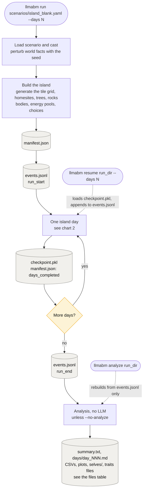

# How a run works, day by day

Three levels: the whole run, one island day, and one hour inside it. Then two tables: every
LLM call, and every file a run writes.

Legend, in all three charts:
- **purple, rounded:** an LLM call
- **yellow:** a check, or a choice the villager made earlier
- **grey cylinder:** something written to disk
- everything else is plain code: the world, bodies and the grid, with no LLM

## 1. The whole run

## 2. One island day (05:00 to 05:00)

```mermaid
flowchart TD
    classDef llm fill:#e9e3fb,stroke:#6250d6,color:#1b1240
    classDef file fill:#f1f0ec,stroke:#8a8984,color:#0b0b0b
    classDef gate fill:#fdf3d6,stroke:#eda100,color:#0b0b0b

    subgraph morning["05:00 new day, no LLM"]
        nd["World: day + 1, date and weather<br/>pending home moves happen, pending ordinance starts<br/>rocks refill, money rock drawn, shells and fossil spots reset<br/>trees regrow, saplings grow, shops restock<br/>everyone's 'today' list is cleared"]
        en["Energy: every pool refills to the daily budget"]
        gr["Grid: broken rocks come back somewhere new<br/>new shell and dig-spot tiles, what villagers had seen is forgotten"]
        mv["Villagers whose home moved overnight start at the new home"]
        ds[("events.jsonl: day_start")]
        nd --> en --> gr --> mv --> ds
    end

    d0{"Day 0?"}
    settle["Everyone lands at 05:00<br/>Tom Nook's tent on a random free homesite<br/>one of each tool, no tool recipes"]
    arr[("events.jsonl: arrival x10")]
    mail["Mail: yesterday's letters and parcels arrive<br/>new recipe cards are learned<br/>a parcel that doesn't fit waits"]
    mev[("events.jsonl: gift, by mail")]

    subgraph window["Each villager's planning times: on waking, and halfway through their waking hours"]
        who["Villagers awake in the window with actions left"]
        habitq{"Chose 'next: habit'<br/>last time?"}
        afford{"Enough energy<br/>to read the prompt?"}
        plan(["LLM: plan<br/>full rules + action menu<br/>status, memories and recent notes, the 8 oldest unread letters<br/>Isabelle's announcement on the first plan"])
        apply["Actions placed at their hours, one per hour, 10 a day<br/>dropped if asleep or no hour free<br/>note kept, choices for plaza, write, next updated"]
        habit["Repeat yesterday's actions for this window<br/>free, 'next' resets to plan"]
        tired["Repeat yesterday's actions<br/>counted as ran out"]
        pl[("events.jsonl: plan")]
        hours["Each hour of the window<br/>see chart 3"]
        who --> habitq
        habitq -- yes --> habit
        habitq -- no --> afford
        afford -- yes --> plan --> apply
        afford -- no --> tired
        apply --> pl
        habit --> pl
        tired --> pl
        pl --> hours
    end

    subgraph night["End of day"]
        mem["Memory: today becomes 'yesterday'<br/>notes trimmed to the last 15"]
        snap[("events.jsonl: snapshot<br/>bells, items, homes, museum, objects on the grid")]
        wq{"Chose to write<br/>tonight?"}
        wa{"Enough energy?"}
        refl(["LLM: nightly page<br/>free form, up to 150 words, private"])
        page["Page replaces last night's<br/>system prompts rebuilt with it"]
        rf[("events.jsonl: reflection")]
        enl[("events.jsonl: energy<br/>spent by kind, left, skipped, tokens")]
        isa(["LLM: Isabelle's report<br/>reads the day's events"])
        isaf[("days/day_NNN_isabelle.md<br/>events.jsonl: isabelle_summary")]
        ann(["LLM: Isabelle's announcement<br/>off by default"])
        mem --> snap --> wq
        wq -- yes --> wa
        wa -- yes --> refl --> page --> rf
        wa -- no --> rf
        wq -- no --> rf
        rf --> enl --> isa --> isaf --> ann
    end

    ckpt[("checkpoint.pkl")]

    ds --> d0
    d0 -- yes --> settle --> arr --> mail
    d0 -- no --> mail
    mail --> mev --> who
    hours -- "next window" --> who
    hours -- "after 04:00" --> mem
    ann --> ckpt

    class plan,refl,isa,ann llm
    class ds,arr,mev,pl,snap,rf,enl,isaf,ckpt file
    class d0,habitq,afford,wq,wa gate
```

## 3. One hour

```mermaid
flowchart TD
    classDef llm fill:#e9e3fb,stroke:#6250d6,color:#1b1240
    classDef file fill:#f1f0ec,stroke:#8a8984,color:#0b0b0b
    classDef gate fill:#fdf3d6,stroke:#eda100,color:#0b0b0b

    social{"20:00 or 21:00?"}
    subgraph plaza["Plaza round"]
        pwho["20:00: everyone awake who chose 'plaza: true'<br/>21:00: only those with new trade offers waiting"]
        pafford{"Enough energy?"}
        eve(["LLM: plaza<br/>rules without the action menu<br/>letters, board, offers waiting"])
        papply["Answer offers: accept = trade swaps on the spot, counter, reject<br/>a board post, new offers<br/>letters and parcels leave now, arrive tomorrow morning"]
        pskip["Skips the plaza"]
        pev[("events.jsonl: evening_turn, message, parcel<br/>board, offer, offer_update, trade")]
        pwho --> pafford
        pafford -- yes --> eve --> papply --> pev
        pafford -- no --> pskip --> pev
    end

    tick["Grid: bugs and fish shadows appear and leave"]
    order["Scheduled actions this hour<br/>ordered by walking distance, ties are luck"]
    act["Body: no tool for it? fail without setting out<br/>find the target, walk there with the ladder and pole carried<br/>World: apply the rule, or say why it failed<br/>the hour is used either way"]
    wear["Wear: the tool used, and the ladder or pole if the route climbed or jumped<br/>50 uses and it breaks"]
    aev[("events.jsonl: action, tool_broke<br/>result, delta, pools_delta, position")]
    free["Everyone else: asleep at home, at home,<br/>or a short walk, and the trip home wears the ladder or pole too"]
    look["Each awake villager sees what's within 8 tiles<br/>bugs, fish shadows, shells, dig spots"]
    sev[("events.jsonl: sighting, seen")]
    near["Who is near whom, neighbors notice<br/>each other heading out"]

    subgraph visit["Visits"]
        vq{"Host home and awake?"}
        vin["Guest sees inside"]
        vno["Nobody answers, the host is told later"]
        vev[("events.jsonl: visit")]
    end

    subgraph enc["Encounters, up to 4 decisions and 2 chats per villager a day"]
        nafford{"Enough energy?"}
        notice(["LLM: notice<br/>short prompt: persona, nightly page, last events<br/>approach someone nearby? opening line"])
        ntired["Too tired to talk to anyone"]
        dev[("events.jsonl: encounter_decision")]
    end

    subgraph chat["One-on-one chat, 2 lines by default"]
        cafford{"Enough energy?"}
        talk(["LLM: chat turn<br/>rules without the action menu<br/>say something, give or ask for items"])
        nod["Just nods"]
        cev[("events.jsonl: encounter, gift<br/>favor_asked, favor_done")]
    end

    hs[("events.jsonl: hour_state<br/>every villager's activity, place, bells, items")]

    social -- yes --> pwho
    social -- no --> tick
    pev --> tick
    tick --> order --> act --> wear --> aev --> free --> look --> sev --> near
    near --> vq
    vq -- yes --> vin --> cafford
    vq -- no --> vno --> vev
    near --> nafford
    nafford -- yes --> notice --> dev
    nafford -- no --> ntired --> dev
    dev -- "approached someone" --> cafford
    cafford -- yes --> talk --> cev
    cafford -- no --> nod --> cev
    vin --> vev
    dev -- "didn't approach" --> hs
    vev --> hs
    cev --> hs

    class eve,notice,talk llm
    class pev,aev,sev,vev,dev,cev,hs file
    class social,pafford,vq,nafford,cafford gate
```

## Every LLM call

All villager calls draw on the villager's one daily energy pool. Each is charged for its
prompt minus the fixed system prompt (the nightly page counts) plus the reply. Reading other
villagers' mail is booked as talking, even inside a plan. A call that
can't be afforded isn't made.

| call | who | when | system prompt | reply | if it can't be afforded | logged as |
|---|---|---|---|---|---|---|
| plan | each awake villager with actions left | on waking and halfway through their waking hours, unless they chose habit | full rules + action menu | JSON: thoughts, actions, note, plaza / write / next | repeats yesterday | `plan` |
| plaza | villagers who chose to go | 20:00; 21:00 only with new offers waiting | rules, no menu | JSON: thoughts, letters, board, offers, responses, parcels, note | skips the plaza | `evening_turn` and more |
| notice | a villager with someone nearby, out of the house | any hour, up to 4 a day | short: persona, nightly page | JSON: thoughts, approach, opening line | too tired to talk | `encounter_decision` |
| chat turn | the one who was approached, then back and forth | right after a notice or a visit | rules, no menu | JSON: thoughts, say, give, ask, note | just nods | `encounter` |
| nightly page | villagers who chose to write | end of day | short: persona, nightly page | free text, up to 150 words, then optionally `Remember:` and up to 3 things to hold on to | doesn't write; old page stays, nothing new is remembered | `reflection` |
| Isabelle's report | Isabelle (not charged) | end of day, if `isabelle.summary` (on) | Isabelle | free text, 150 to 300 words | always made | `isabelle_summary` |
| Isabelle's announcement | Isabelle (not charged) | end of day, if `isabelle.announce` | Isabelle | free text, read in the next morning's plan | always made | `isabelle_announcement` |

Day 0 has no extra call: homesites are drawn, not chosen.

## Every file a run writes

All in the run directory, `runs/<timestamp>_<scenario>_s<seed>/` or `--run-dir`.

| file | written | what it holds |
|---|---|---|
| `manifest.json` | at the start; `days_completed` after each day | scenario, perturbed world, villagers, system prompts |
| `events.jsonl` | as things happen, one JSON line each | everything: day_start, arrival, plan, action, sighting, seen, visit, encounter_decision, encounter, gift, favor_asked, favor_done, evening_turn, message, parcel, board, offer, offer_update, trade, tool_broke, hour_state, snapshot, reflection, memory, energy, isabelle_summary, run_start, run_end, resume, intervention |
| `checkpoint.pkl` | after each day | the whole simulation, for `llmabm resume` |
| `days/day_NNN_isabelle.md` | end of each day | Isabelle's report |
| `prompts/dNNN_*_<name>.txt` | each LLM call, with `--log-prompts` | the exact system and user prompt, then the hidden reasoning (if any) and the reply |
| `days/day_NNN.md` | analysis | the day hour by hour, private thoughts marked 🔒, end-of-day table, nightly pages |
| `summary.txt` | analysis | resources, museum, trades, time use, weather, sightings, social ties, energy |
| `hourly_villagers.csv`, `hourly_island.csv` | analysis | one row per villager per hour; one row per hour for the island |
| `networth.png`, `extraction.png`, `museum.png`, `commons.png`, `activity_by_hour.png` | analysis | plots |
| `island_map.png`, `tracks_day_NNN.png` | analysis | the island after the last day, and where everyone walked that day |
| `traits_daily.csv`, `villagers_env.csv` | analysis, with reflection on | behaviour per villager per day; what each villager was dealt |
| `selves/<name>.md` | analysis, with reflection on | each villager's nightly pages in order |
| `traits_divergence.png`, `traits_profile.png` | analysis, with reflection on | how far apart villagers drift, and their recent profiles |

Outside the run directory, `.cache/llm/` keeps every LLM reply, keyed on the prompt and seed,
so rerunning the same seed replays for free.
