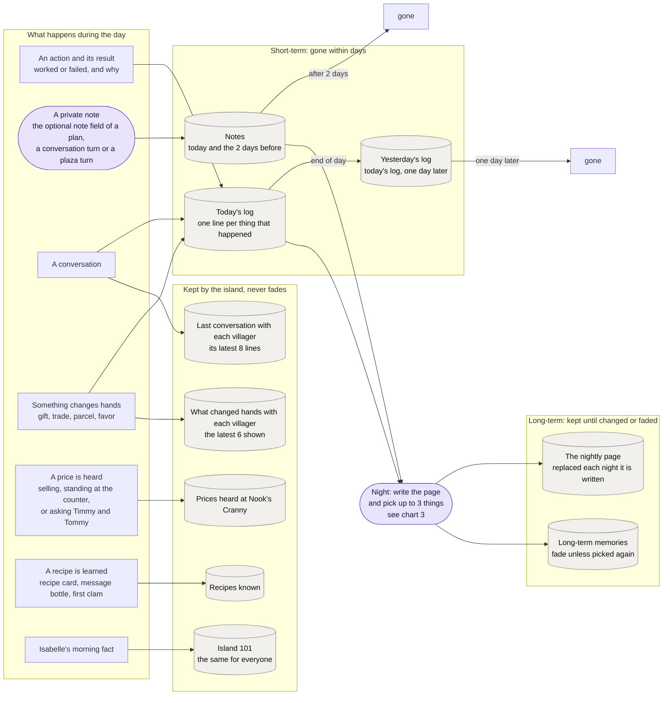
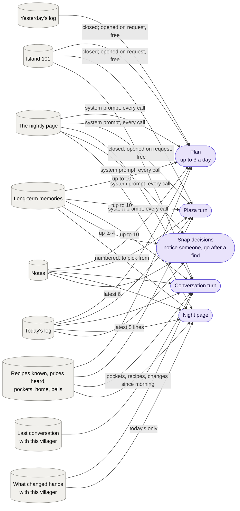
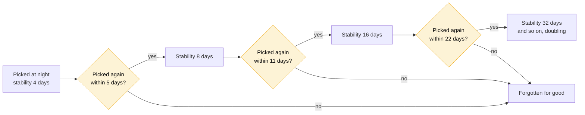

# What villagers keep, and how they learn

Four charts: where everything a villager experiences ends up, which prompt reads what, what
happens at night, and the life of one long-term memory. Then a table of every store, the
settings, and what `runs/test1` shows so far. The run as a whole is in [day_flow.md](day_flow.md).

A villager has no memory of its own between calls. Everything it "knows" in a call is text the
simulation puts in that call's prompt, so memory here means: what is stored, for how long, and
which prompts show it.

Legend, in all four charts:
- **purple, rounded:** an LLM call
- **yellow:** a check, or a choice the villager made
- **grey cylinder:** something stored between calls
- everything else is plain code

## 1. Where a day's experience goes

Read it left to right: what happens, where it is stored, how long it lasts.



The only way anything from today's log or the notes lasts beyond those few days is the night
call: the villager writes it into their page, or picks it as a memory.

## 2. Which prompt reads what



Two things follow from this chart:
- **Yesterday's log is read only when planning.** In a conversation, at the plaza and at night a
  villager sees today but not yesterday.
- **Recipes and prices are not memory.** The island keeps them and prints them in full in every
  plan, plaza and conversation prompt. From prompt version 8 each known recipe is listed with
  what it needs and how much of that the villager has.

## 3. The night

One call per villager, after the day ends. It is the only place long-term memory is written.

```mermaid
flowchart TD
    classDef llm fill:#e9e3fb,stroke:#6250d6,color:#1b1240
    classDef file fill:#f1f0ec,stroke:#8a8984,color:#0b0b0b
    classDef gate fill:#fdf3d6,stroke:#eda100,color:#0b0b0b

    start["End of day"]
    chose{"Chose to write tonight?"}:::gate
    energy{"Enough mental energy<br/>to read the prompt?"}:::gate
    nothing["Nothing is written<br/>the old page stays, no new memories"]
    call(["Night call<br/>reads: today's log, what changed hands today,<br/>what they have, notes, numbered memories, last night's page"]):::llm
    split["Split the reply at the line Remember:"]
    pagetext["Before it: the page<br/>free-form, up to 150 words"]
    picks["After it: up to 3 short lines"]
    page[("The nightly page<br/>replaces last night's")]:::file
    kind{"Is the line a number<br/>from tonight's list?"}:::gate
    rehearse["Rehearse that memory<br/>stability doubles, clock restarts"]
    new["New memory<br/>the line in their own words, up to 200 characters<br/>stability 4 days"]
    mem[("Long-term memories")]:::file
    fade{"Strength tomorrow<br/>below 0.25?"}:::gate
    forgot["Forgotten for good<br/>logged in a memory event"]
    keep["Kept<br/>shown tomorrow if among the 10 strongest"]
    trim["Notes older than 2 days are dropped<br/>today's log becomes yesterday's"]

    start --> chose
    chose -- no --> nothing
    chose -- yes --> energy
    energy -- no --> nothing
    energy -- yes --> call --> split
    split --> pagetext --> page
    split --> picks --> kind
    kind -- yes --> rehearse --> mem
    kind -- no --> new --> mem
    nothing --> fade
    mem --> fade
    fade -- yes --> forgot
    fade -- no --> keep
    forgot --> trim
    keep --> trim
```

The page prompt is deliberately open: no topics, no questions, no format beyond the length cap.
The pick instruction says only that a line can be something from today in their own words, or
the number of something they already remember that is still on their mind.

## 4. The life of one memory

Strength is `exp(-days since last picked / stability)`. A memory is forgotten the first night
its strength for the next day is below 0.25.



| Times picked | Stability | Lasts this long without being picked again |
|---|---|---|
| 1 | 4 days | 5 days, gone on the 6th |
| 2 | 8 days | 11 days, gone on the 12th |
| 3 | 16 days | 22 days, gone on the 23rd |
| 4 | 32 days | 44 days, gone on the 45th |

Being shown a memory in a prompt does not count as recalling it. Only picking it again at night
does.

## Every store

| Store | Written by | Kept for | Shown in |
|---|---|---|---|
| Today's log | the simulation, one line per action, conversation, visit, find or failure | the day | every call (snap decisions: the latest 5 lines) |
| Yesterday's log | today's log, copied at the end of the day | one day | plans only |
| Notes | the villager, in the optional `note` of a plan, a conversation turn or a plaza turn | today and the 2 days before | every call (snap decisions: the latest 6) |
| The nightly page | the villager, at night | until the next night they write | the system prompt of every call |
| Long-term memories | the villager, after the page, up to 3 a night | see chart 4 | plans, plaza and conversation turns (up to 10, strongest first, then in the order they happened); snap decisions (up to 4); numbered at night |
| Last conversation with each villager | the simulation | until the pair talks on a later day | conversation turns with that villager (the latest 8 lines, each up to 200 characters) |
| What changed hands with each villager | the simulation | the whole run | conversation turns with that villager (the latest 6); today's at night |
| Prices heard | the simulation: on selling, at the Cranny counter, on asking Timmy and Tommy | the whole run, updated when heard again | plans, plaza and conversation turns |
| Recipes known | the simulation: a recipe card, a message bottle, the first clam | the whole run | plans, plaza and conversation turns, with what each needs; names only at night |
| Island 101 | worked out from the island's rules: Isabelle's morning facts so far | the whole run, the same for everyone | plans, plaza and conversation turns, closed; one free look per prompt |
| Typical energy costs | the simulation: the average cost so far of each kind of call, across all villagers | the whole run | plans and plaza turns |

Not stored anywhere a villager can read: their own earlier plans and the private `thoughts` in
them, earlier pages (each replaces the last), conversations before the last one with each
villager, and anything from two or more days ago that wasn't written into the page or picked.

## Settings

In the scenario file (`scenarios/island_blank.yaml`):

```yaml
reflection:
  enabled: true
  max_words: 150        # the page; cut at 1.3 times this
memory:
  mode: consolidate     # without this block: keep the last memory_size notes, nothing else
  picks: 3              # things to hold on to per night
  shown: 10             # memories in a prompt at most
  stability: 4          # days, for a new memory
  threshold: 0.25       # forgotten below this strength
  notes_days: 2         # how long a note lasts
```

The code is in `src/llmabm/island/memory.py` (picking, fading, forgetting),
`prompts.py` (`memory_block`, `reflect_prompt`, `last_chat_with`, `exchanges_with`,
`island_101`) and `sim.py` (`_reflect`, `_forget`).

## Where to read it for a run

- `villagers/<name>/memory.md`: what a villager carries into their prompts as of the last
  finished day, each memory with its strength and the day it fades, then night by night what
  they held on to, came back to and forgot.
- `villagers/<name>/pages.md`: their nightly pages in order.
- `events.jsonl`: `reflection` events (the page, `remembered`, `rehearsed`, or why it was
  skipped) and `memory` events (how many are kept, what was forgotten).

## What test1 shows so far (13 days, 10 villagers)

Counted from `runs/test1/events.jsonl`; these are observations, not conclusions.

- **Long-term memory has only been on since day 8.** Before that, villagers kept notes and the
  page only. Nothing has faded yet: the earliest memories are from day 8 and would first be
  forgotten on the night of day 13.
- **Four nights in ten, nothing is written.** Of 130 villager-nights, 51 were skipped for lack
  of mental energy: the page stayed as it was and nothing from that day was kept. On day 12,
  8 of 10 villagers were out of energy by night.
- **Whoever writes always picks 3.** Since day 8 that is 24 nights, 64 new memories and 8
  rehearsals (5 of them on day 11).
- **What gets picked is mostly today's state.** A sample: "No bait yet.", "6,750 bells in the
  tent.", "Shovel uses 29 left.", "No trades today", "Dax still wants bait, I owe him one.",
  "Cal: offered 1 wood for bait, need to confirm". Several repeat what the prompt already
  prints every time (bells, pockets, tool uses).
- **Notes are used often.** 272 of 364 plans carried a note.
- **Nobody has opened the Island 101** (0 lookups), though it has only been there for one day:
  the run moved to prompt version 19 on day 12.
- **Knowing a recipe hasn't led to using it.** 4 craft attempts in 1,090 actions, all on days 2
  to 5. One villager bought a recipe card he already knew (day 2, prompt version 5, before
  cards were marked "you know it"), and the next day tried to craft a recipe he didn't know,
  with materials he guessed.
- **The run changed under them.** The prompt version moved 11 times in 13 days (1 to 19), so
  early and late days are not the same conditions. A clean read of memory needs a run that
  starts on the current version.
