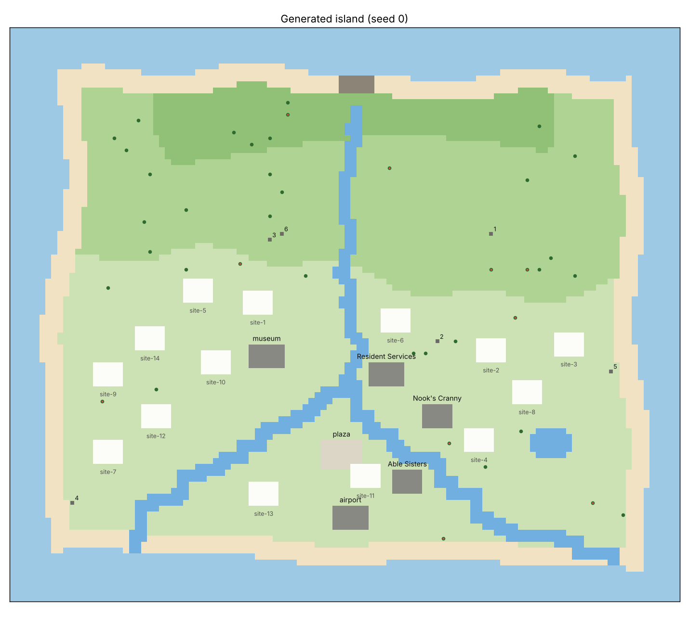

# The island world

Everything on the island, for you. Villagers never see this page: they learn the island by
trying things, asking the NPCs and talking to each other (see the README). Generated by
`scripts/world_doc.py` from `data/island_world.yaml` and the island generator; rerun it after
changing either. Day starts at 05:00.

## The map

Every run generates its island from the seed, so each seed gives a different island built the same
way. This is seed 0, before anyone arrives. North is at the top.

**How it's built.** A 112 x 96 tile grid: a sea margin of 7 tiles, a beach
3 tiles wide all round, and grass on three cliff tiers that rise toward the north.
A river starts on the top cliff, drops down the tiers and splits on its way to the sea
(2 mouths on this island). There is one pond, and a rocky stretch of the north beach that
can't be walked. The buildings and all 14 homesites are on the lower ground. Trees and
rocks each take one tile and need the 8 tiles around them clear of other trees, rocks, buildings,
water and cliff edges.

| tile | count | share |
|---|---|---|
| sea | 2,746 | 26% |
| beach | 1,093 | 10% |
| rocky beach | 18 | <1% |
| lower ground | 3,826 | 36% |
| the middle cliff | 2,074 | 19% |
| the top cliff | 580 | 5% |
| river (the top cliff) | 13 | <1% |
| river (the middle cliff) | 45 | <1% |
| river (lower ground) | 326 | 3% |
| pond | 31 | <1% |

**Getting around.** Beach and grass are walkable. Trees, rocks, buildings, homes, placed furniture
and fences block their tiles; the plaza doesn't. Going up or down one cliff tier needs a **ladder**.
Crossing the river needs a **vaulting pole**, which clears up to 3 tiles of water,
except over a built bridge. The river is 3.1 tiles across on average
(measured straight across at each river tile; 2 to 8). The pond and the sea can
never be crossed. Everyone starts with both, and they wear out (see Tools). Trees, rocks, buildings
(the plaza too) and homes always keep at least one free tile between them.

**Bridges and stairs.** The first bridge goes across 2 tiles of river on lower ground, centre, near Resident Services; it costs
98,000 bells, raised by anyone at Resident Services, and once built it is a way across the
river without a pole. Villagers can propose more bridges, and stairs, where they stand, each built
once its own fund reaches 98,000 bells; 10 in all, built or proposed, the first bridge
included, and one proposal of each villager's still being funded at a time. A bridge is 3 tiles wide
and crosses at most 4 tiles of lower river, with a landing on each bank (the first
bridge too); stairs are 2 tiles wide and 4 long, two rows below a cliff edge and two above, and let
anyone climb there without a ladder. Every land tile under one has to be clear, it has to be at least
6 tiles from any other, and from the moment it's proposed nothing can be planted or put
on it. This island has 28 spots for a bridge and 130 for stairs before any
are taken. They only give access. (In runs on prompt versions before 17, the first bridge also adds
3 rocks and 10 hardwood trees at
random places when built, and villagers can't propose more.)

What you can reach from Resident Services:

| carrying | land | rocks | trees | buildings | homesites |
|---|---|---|---|---|---|
| no tools | 22% | 3 of 6 | 3 of 40 | 2 of 6 | 6 of 14 |
| vaulting pole | 59% | 4 of 6 | 22 of 40 | 6 of 6 | 14 of 14 |
| ladder | 82% | 6 of 6 | 35 of 40 | 3 of 6 | 13 of 14 |
| both | 94% | 6 of 6 | 40 of 40 | 6 of 6 | 14 of 14 |

**Buildings**

| building | size (tiles) | where | notes |
|---|---|---|---|
| Resident Services | 6 x 4 | lower ground, centre |  |
| plaza | 7 x 5 | lower ground, south | walkable |
| museum | 6 x 4 | lower ground, centre |  |
| Nook's Cranny | 5 x 4 | lower ground, south |  |
| Able Sisters | 5 x 4 | lower ground, south |  |
| airport | 6 x 4 | lower ground, south |  |

**Homesites.** 14 sites of 5 x 4 tiles on the lower ground, at least
9 tiles apart: centre 2; east 3; south 1; southeast 2; southwest 2; west 4.
Villagers whose homes are in the same area are neighbors and notice each other heading out. On day 0
each villager gets one at random; moving costs 10,000 bells.

**Trees** (40 at the start; chopped-down trees leave a stump and don't come back)

| tier | hardwood | fruit |
|---|---|---|
| lower ground | 17 | 5 |
| the middle cliff | 11 | 4 |
| the top cliff | 2 | 1 |

**Rocks** (6; a broken rock turns up somewhere new after
3 days)

| rock | where |
|---|---|
| 1 | lower ground, southeast |
| 2 | the middle cliff, northwest |
| 3 | the top cliff, northeast |
| 4 | lower ground, centre |
| 5 | lower ground, southeast |
| 6 | lower ground, southeast |

**Flowers.** 6 patches of wild flowers at the start, which bugs visit.

**What lives where, and what villagers can see.** Villagers see 8 tiles around
them. Fish show as shadows at the water's edge, at most 14 in the sea, 10 in the river, 3 in the pond and 3 in the river up on the cliffs at a time. Bugs sit where
they live, at most 6 on flowers, 5 on trees, 2 on stumps, 2 on rocks, 6 in the grass. Shells (12 a day) lie on the beach and
fossil dig spots (4 a day) on the grass, in new places every
morning, and a villager only knows the ones they have seen. Fish and bugs come and go by the hour.

## What the island gives

| resource | how much | refills |
|---|---|---|
| rocks | 6 rocks, 8 items each a day (stone 50%, clay 20%, iron nugget 25%, gold nugget 5%); one rock a day pays 100 to 1,800 bells a hit instead | every morning |
| hardwood trees | 30 trees, 3 wood a day each (wood, softwood, hardwood) | every morning |
| fruit trees | 10 trees, 3 apples each | 3 days after shaking |
| shells | 12 a day on the beach, up to 4 per beachcombing; 15% chance of a message bottle with a recipe | every morning |
| fossils | 4 dig spots a day | every morning |
| fish and bugs | by hour, month and weather; 15% of tries get away | hour by hour |
| saplings and fruit | planted, they grow into trees in 5 days |  |
| flower seeds | bloom in 3 days |  |

## Tools

Everyone starts with one of each, except the axe, which is an upgrade (its recipe card is at
Nook's Cranny); nobody knows how to make them. Each breaks after 30
uses. Without the tool an action fails before the villager sets out. Villagers aren't told how worn a
tool is; they find out when it breaks (from prompt version 12 they see each tool's uses left). A
replacement takes the tool's recipe card (always at Nook's Cranny,
200 bells) and materials, or the tool itself, ready-made (4x its sell value). Spare tools can be handed over
or mailed, and a worn tool stays worn.

| tool | worn by | made from |
|---|---|---|
| shovel | mine_rock, dig_fossil, dig_stump, break_rock | 5 hardwood |
| stone axe | chop_wood (the tree stays) | 5 stone |
| fishing rod | fish | 4 wood |
| net | catch_bug | 4 softwood |
| ladder | each trip whose route climbs a cliff | 4 wood, 4 hardwood, 4 softwood |
| vaulting pole | each trip whose route jumps the river | 5 wood |
| axe | chop_wood; brings the tree down with its last wood (a fruit tree drops its fruit) | 3 wood, 1 iron nugget |

## Items

### Materials (gathered)

| item | where it comes from | sells for |
|---|---|---|
| wood | chop_wood | 60 |
| softwood | chop_wood | 60 |
| hardwood | chop_wood | 60 |
| stone | mine_rock | 75 |
| clay | mine_rock | 100 |
| iron nugget | mine_rock | 375 |
| gold nugget | mine_rock, rarely | 10,000 |
| apple | shake_tree; eat one to break_rock | 100 |
| sapling | Nook's Cranny | 160 |
| manila clam |  | 100 |

### Recipes (28)

Everyone knows the ones marked ★ from day 0, plus 3 drawn at random from the
rest (never a tool). More come on recipe cards: the Cranny's tool cards and its one other card a
day, message bottles on the beach, and other villagers. A card for a recipe you don't know is
learned on the spot; a card for one you know stays in your pockets to give, mail, trade or sell.
Furniture can go inside a home (visitors see it) or outside, where it blocks its tiles. Fences come
out in pieces of one tile.

| recipe | needs | sells for | notes |
|---|---|---|---|
| shovel | 5 hardwood | 200 | tool |
| stone axe | 5 stone | 150 | tool |
| axe | 3 wood, 1 iron nugget | 300 | tool |
| fishing rod | 4 wood | 150 | tool |
| net | 4 softwood | 150 | tool |
| ladder | 4 wood, 4 hardwood, 4 softwood | 600 | tool |
| vaulting pole | 5 wood | 300 | tool |
| log stool | 3 wood | 360 |  |
| log bench | 4 wood, 2 hardwood | 480 | 2 x 1 tiles |
| wooden chair | 4 wood, 2 softwood | 540 |  |
| wooden bookshelf | 6 wood, 4 hardwood | 900 | 2 x 1 tiles |
| campfire | 3 wood | 180 |  |
| stone stool | 3 stone | 340 |  |
| stone lion-dog | 10 stone | 1,200 |  |
| clay furnace | 6 clay, 2 iron nugget | 2,100 |  |
| brick oven | 8 clay, 4 stone | 1,600 | 2 x 2 tiles |
| street lamp | 4 iron nugget, 2 clay | 1,900 |  |
| iron worktable | 5 iron nugget, 4 wood | 2,600 | 2 x 1 tiles |
| iron garden bench | 3 iron nugget, 4 hardwood | 1,700 | 2 x 1 tiles |
| fruit basket | 6 apple, 2 softwood | 900 |  |
| shell table | 2 giant clam, 2 venus comb, 1 conch | 2,400 | 2 x 1 tiles |
| gold crown | 6 gold nugget | 67,000 |  |
| golden candlestick | 1 gold nugget, 3 iron nugget | 12,000 |  |
| ironwood dresser | 4 iron nugget, 8 hardwood, 4 wood | 3,400 | 2 x 1 tiles |
| ★ simple wooden fence | 3 wood | 60 | makes 5 |
| fishing bait | 1 manila clam | 75 |  |
| stone fence | 3 stone | 75 | makes 5 |
| iron fence | 2 iron nugget | 150 | makes 5 |

### Bought

Shop goods sell back for a quarter of their price.

| item | shop | stock | price | what it is |
|---|---|---|---|---|
| sapling | Nook's Cranny | always in stock | 640 | plant: a hardwood tree |
| tulip seeds | Nook's Cranny | 2 kinds a day | 240 | plant: flowers |
| cosmos seeds | Nook's Cranny | 2 kinds a day | 240 | plant: flowers |
| pansy seeds | Nook's Cranny | 2 kinds a day | 240 | plant: flowers |
| hyacinth seeds | Nook's Cranny | 2 kinds a day | 240 | plant: flowers |
| fishing bait | Nook's Cranny | 3 a day | 300 | fish with "bait": true and a fish is sure to appear |
| wooden mini table | Nook's Cranny | 3 a day | 1,800 | furniture |
| garden lantern | Nook's Cranny | 3 a day | 2,200 | furniture |
| ceiling fan | Nook's Cranny | 3 a day | 4,600 | furniture, indoor only |
| record player | Nook's Cranny | 3 a day | 9,800 | furniture |
| simple wooden fence | Nook's Cranny | 3 a day | 100 | fence, makes a 1-tile piece |
| iron fence | Nook's Cranny | 3 a day | 280 | fence, makes a 1-tile piece |
| every tool's recipe card | Nook's Cranny | always in stock | 200 | learn to make that tool |
| every tool, ready-made | Nook's Cranny | always in stock | 4x its sell value | a new tool |
| one other recipe card | Nook's Cranny | 1 a day, never a tool | 800 | learn the recipe |
| straw hat | Able Sisters | 4 a day | 800 | hat: a wide-brimmed straw hat |
| sundress | Able Sisters | 4 a day | 1,400 | dress: a light cotton sundress |
| denim jacket | Able Sisters | 4 a day | 2,200 | top: a faded denim jacket |
| raincoat | Able Sisters | 4 a day | 1,600 | top: a bright yellow raincoat |
| rose crown | Able Sisters | 4 a day | 1,200 | hat: a crown of small roses |
| bowler hat | Able Sisters | 4 a day | 900 | hat: a black bowler hat |
| kimono | Able Sisters | 4 a day | 4,800 | dress: a patterned kimono |
| tuxedo | Able Sisters | 4 a day | 3,200 | top: a black tuxedo jacket |

### Collectibles (museum or Nook's Cranny)

Blathers takes the first of each species, and the museum shows who donated each one and how many
each villager has given. Names below are the unperturbed ones; see the last section.

A dug-up fossil is a plain "fossil" until Blathers assesses it (free, at the museum, `assess`).
Unassessed, Nook's Cranny pays 400 for it and the museum won't take it. Assessed, it
becomes one species, picked at random, worth its price below; perturbation keeps fossil prices
between 1,000 and 10,000.

| kind | species | sells for | how |
|---|---|---|---|
| fish | 19 | 120-15,000 | fish, in the sea, river (also on cliffs) or pond |
| bugs | 16 | 160-12,000 | catch_bug on flowers, trees, stumps, rocks or the ground |
| fossils | 12 | 1,000-6,000 | dig_fossil, then assess at the museum |
| shells | 8 | 60-700 | beachcomb |

Every fish, bug, fossil and shell

| fish | sells for | shadow | where | hours | months | weather |
|---|---|---|---|---|---|---|
| sea bass | 400 | 5 | sea | all day | all year | any |
| horse mackerel | 150 | 2 | sea | all day | all year | any |
| anchovy | 200 | 2 | sea | 04:00-21:00 | all year | any |
| red snapper | 3,000 | 4 | sea | all day | all year | any |
| olive flounder | 800 | 5 | sea | all day | all year | any |
| squid | 500 | 3 | sea | all day | 12, 1, 2, 3, 4, 5, 6, 7, 8 | any |
| barred knifejaw | 5,000 | 3 | sea | all day | 3, 4, 5, 6, 7, 8, 9, 10, 11 | any |
| tuna | 7,000 | 6 | sea | all day | 11, 12, 1, 2, 3, 4 | any |
| crucian carp | 160 | 2 | river | all day | all year | any |
| dace | 240 | 3 | river | 16:00-09:00 | all year | any |
| pale chub | 200 | 1 | river | 09:00-16:00 | all year | any |
| black bass | 400 | 4 | river | all day | all year | any |
| char | 3,800 | 3 | clifftop | 16:00-09:00 | 3, 4, 5, 6, 9, 10, 11 | any |
| golden trout | 15,000 | 3 | clifftop | 16:00-09:00 | 3, 4, 5, 9, 10, 11 | any |
| carp | 300 | 4 | pond | all day | all year | any |
| goldfish | 1,300 | 1 | pond | all day | all year | any |
| koi | 4,000 | 4 | pond | 16:00-09:00 | all year | any |
| frog | 120 | 2 | pond | all day | 5, 6, 7, 8 | any |
| coelacanth | 15,000 | 6 | sea | all day | all year | wet |

| bug | sells for | habitat | hours | months | weather |
|---|---|---|---|---|---|
| common butterfly | 160 | flowers | 04:00-19:00 | 9, 10, 11, 12, 1, 2, 3, 4, 5, 6 | dry |
| yellow butterfly | 160 | flowers | 04:00-19:00 | 3, 4, 5, 6, 9, 10 | dry |
| peacock butterfly | 2,500 | flowers | 04:00-19:00 | 3, 4, 5, 6 | dry |
| emperor butterfly | 4,000 | flowers | 17:00-08:00 | 12, 1, 2, 3, 6, 7, 8, 9 | dry |
| honeybee | 200 | flowers | 08:00-17:00 | 3, 4, 5, 6, 7 | dry |
| wasp | 2,500 | trees | all day | all year | any |
| mantis | 430 | flowers | 08:00-17:00 | 3, 4, 5, 6, 7, 8, 9, 10, 11 | dry |
| orchid mantis | 2,400 | flowers | 08:00-17:00 | 3, 4, 5, 6, 7, 8, 9, 10, 11 | dry |
| ladybug | 200 | flowers | 08:00-17:00 | 3, 4, 5, 6, 10 | dry |
| grasshopper | 160 | ground | 08:00-17:00 | 7, 8, 9 | dry |
| pill bug | 250 | rocks | 23:00-16:00 | 9, 10, 11, 12, 1, 2, 3, 4, 5, 6 | any |
| stag beetle | 2,000 | trees | all day | 7, 8 | any |
| golden stag | 12,000 | trees | 17:00-08:00 | 7, 8 | any |
| tarantula | 8,000 | ground | 19:00-04:00 | 11, 12, 1, 2, 3, 4 | any |
| snail | 250 | rocks | all day | all year | wet |
| citrus long-horned beetle | 350 | stumps | all day | all year | any |

| fossil | sells for |
|---|---|
| amber | 1,200 |
| ammonite | 1,100 |
| trilobite | 1,300 |
| dinosaur track | 1,000 |
| shark-tooth pattern | 1,000 |
| coprolite | 1,100 |
| archaeopteryx | 1,300 |
| dunkleosteus | 3,500 |
| ankylo skull | 3,500 |
| t. rex skull | 6,000 |
| stego skull | 5,000 |
| ptera body | 4,500 |

| shell | sells for |
|---|---|
| sea snail | 180 |
| cowrie | 60 |
| giant clam | 120 |
| venus comb | 150 |
| scallop | 200 |
| sand dollar | 120 |
| coral | 500 |
| conch | 700 |

## Services and prices

| who | where | open | what they do |
|---|---|---|---|
| Tom Nook | Resident Services | all day | house upgrades on a loan with no interest and no deadline (pay it off before the next one); moves your home for 10,000 bells overnight; bridge and stairs funds (98,000 bells each) |
| Isabelle | Resident Services | all day | sets an ordinance for 20,000 bells, from the next morning |
| Timmy and Tommy | Nook's Cranny | 08:00-22:00 | buy almost anything at a fixed price; sell a small daily stock |
| the Able Sisters | Able Sisters | 09:00-21:00 | sell clothes |
| Blathers | museum | all day | takes the first of each fish, bug and fossil and keeps a public tally of donors; pays nothing; assesses fossils for free |

Everyone carries 40 items. From prompt version 12 a house's storage is room to keep things at
home, reachable only there (a tent has none); before, it added to what you could carry.

| house | storage | furniture inside | costs (Tom Nook loan) |
|---|---|---|---|
| tent | 0 | 6 | 0 |
| house | 80 | 12 | 98,000 |
| bigger house | 120 | 18 | 198,000 |
| house with back room | 240 | 30 | 348,000 |
| two-story house | 320 | 40 | 548,000 |

Ordinances (one at a time):

| ordinance | effect |
|---|---|
| none | no ordinance |
| early bird | everyone keeps earlier hours, and the shops open and close earlier |
| night owl | everyone keeps later hours, and the shops open and close later |
| bell boom | Nook's Cranny pays more for everything, and everything in the shops costs more |

## What changes from run to run

Runs perturb the world with the seed, so models can't lean on what they remember about ACNH:
- every fish, bug, fossil and shell gets an invented name (recipes that use shells follow)
- material, collectible and recipe sell prices are scaled by a random 0.6-1.6x
- each fish gets a new kind of water (sea, river or pond) and new hours

Shop prices, house prices, the bridge and the ordinances stay as above. The island layout comes
from the seed too, so it changes with every seed.
